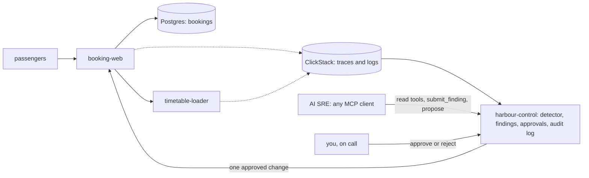

# Start here: meet the harbour

You are the new on-call engineer at Gullrock Ferries, an island ferry company with three routes: Port Maren, Gullrock and Skerry Head. Passengers book a sailing on the web, then check in at the quay, and cars queue by booking reference. When booking breaks, the cost shows the same hour: empty car spaces, drivers at the kiosk with no booking, and a phone queue.

In this orientation you set up the repo, start the world, book a sailing, follow it in HyperDX, and watch the finished AI SRE handle a real fault from page to verified recovery. Every later step builds one piece of what you see here.




## What you need

- Docker with at least 4 GB of memory (8 GB is comfortable), and Bun 1.4.4 from bun.sh.
- No model key. Every command here runs in replay mode, which plays back a recorded AI SRE against your live world. To use a live model later, set `LLM_PROVIDER` and one key in `.env` (see `.env.example`) and run `bun run models`.

## Walkthrough

```bash
bun install
```

Expect: `bun install` ends with no errors.

```bash
bun run world
```

Expect: `The world is up: every service is healthy.` The first start builds four images and pulls ClickStack, which takes a few minutes.

```bash
bun run models
```

Expect: `Every role answers on replay.`

Now open http://localhost:8000, choose the 08:15 Port Maren to Gullrock sailing with a car, and press Book and pay. Write the reference it shows into `meet-the-harbour/problem/answers.md`. Then open http://localhost:8080 (the login is `HYPERDX_USER_EMAIL` and `HYPERDX_USER_PASSWORD` in `.env`), search for your reference, open the `POST /api/bookings` trace, and copy its Trace ID into the same file. The step page, [meet-the-harbour](meet-the-harbour/problem/README.md), shows each screen.

```bash
bun run demo bad-release
```

Expect: `Waiting for a human: approve at http://localhost:8090/actions/...` after the AI SRE's tool calls, one of them a `refused` line for `execute_remediation`.

```bash
bun run approve
```

Expect: `Waiting change act-... for inc-...` with the hypothesis, the change and its blast radius. Read them. You are the approver.

```bash
bun run approve --yes
```

Expect: `Approved act-... as oncall@gullrock.test. Now run bun run demo finish.`

```bash
bun run demo finish
```

Expect: `Resolved: the change was approved by a human, ran once, and recovery was verified.`

```bash
bun run verify meet-the-harbour
```

Expect: `Done. All 4 rules pass.` and a `Progress:` line.

When a command prints something you do not expect, look it up in [troubleshooting.md](troubleshooting.md).
