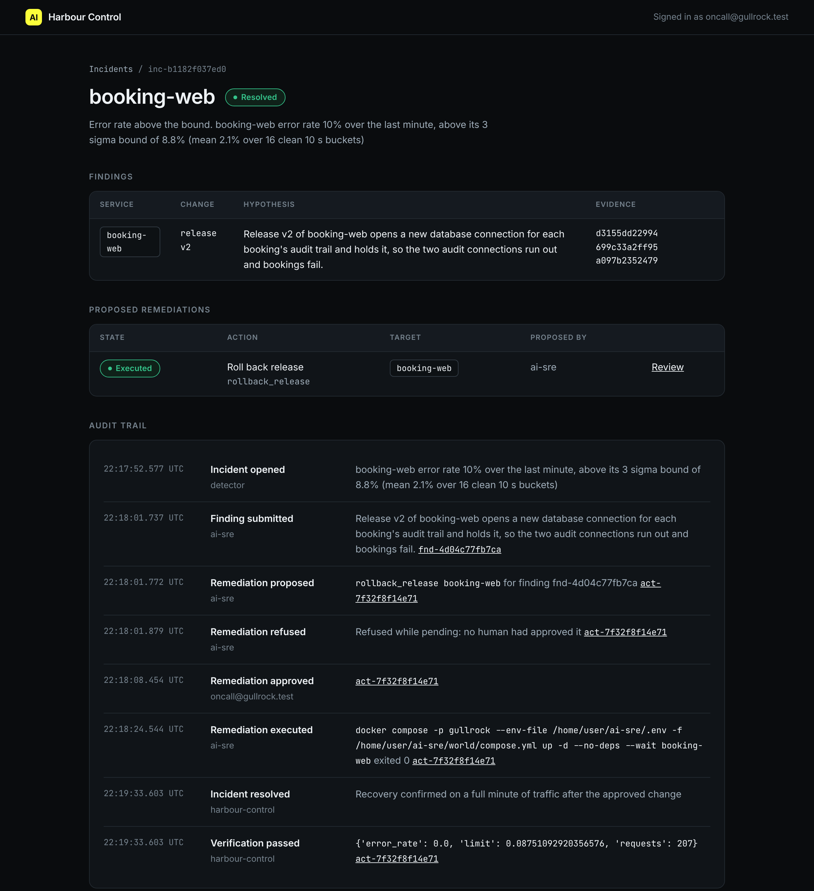
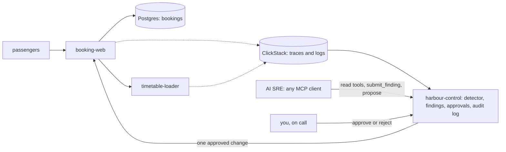

# Start here: meet the harbour

You are the new on-call engineer at Gullrock Ferries. On call means you answer when the system breaks. Gullrock Ferries is an island ferry company with three ports: Port Maren, Gullrock and Skerry Head.

Passengers book a sailing on the website. Then they check in at the quay. Cars queue by booking reference, a code such as `GR-CTZPCM`. When booking breaks, you see the cost at once. Car spaces stay empty. Drivers with no booking wait at the kiosk. The phone queue grows.

In this orientation you do five things:

- set up the repo;
- start the world, the set of ferry services that runs on your computer;
- book a sailing;
- follow that booking in HyperDX, the tool where you search traces and logs;
- watch the finished AI SRE fix a real fault, from the first alert to the checked recovery.

Every later step builds one piece of what you see here.





## What you need

- Docker with at least 4 GB of memory. 8 GB is better.
- Bun 1.4.4, from bun.sh.
- No model key. Every command here runs in replay mode. Replay mode plays back a recorded AI SRE against your live world.

Later you can use a live model. To do that, set `LLM_PROVIDER` and one key in `.env` (see `.env.example`). Then run `bun run models`.

## Walkthrough

```bash
bun install
```

Expect: `bun install` ends with no errors.

```bash
bun run world
```

Expect: `The world is up: every service is healthy.` The first start builds four images and pulls ClickStack, which takes a few minutes.

```bash
bun run models
```

Expect: `Every role answers on replay.`

Now you follow one booking through the system. A trace is the record of one request as it moves through the services. Each trace has a Trace ID, 32 letters and numbers long.

1. Open http://localhost:8000.
2. Choose the 08:15 sailing from Port Maren to Gullrock, with a car.
3. Press Book and pay. The page shows your booking reference.
4. Write that reference into `meet-the-harbour/problem/answers.md`.
5. Open http://localhost:8080. The login is `HYPERDX_USER_EMAIL` and `HYPERDX_USER_PASSWORD` in `.env`.
6. Search for your reference and open the `POST /api/bookings` trace.
7. Copy its Trace ID into the same file.

For example, the sample solution's file has these two lines:

```text
Booking reference: GR-CTZPCM
Trace id: b2fc93d8894696a202c4d28649297fe6
```

Your reference and Trace ID are different. The step page, [meet-the-harbour](meet-the-harbour/problem/README.md), shows each screen.

Next you watch the finished AI SRE handle the `bad-release` fault. In that fault, release v2 of booking-web makes about a third of bookings fail.

```bash
bun run demo bad-release
```

Expect: `Waiting for a human: approve at http://localhost:8090/actions/...` after the AI SRE's tool calls, one of them a `refused` line for `execute_remediation`.

```bash
bun run approve
```

Expect: `Waiting change act-... for inc-...` with the hypothesis, the change and its blast radius. Read them. You are the approver.

The hypothesis is what the AI SRE thinks broke. The blast radius is what the change can affect.

```bash
bun run approve --yes
```

Expect: `Approved act-... as oncall@gullrock.test. Now run bun run demo finish.`

```bash
bun run demo finish
```

Expect: `Resolved: the change was approved by a human, ran once, and recovery was verified.`

```bash
bun run verify meet-the-harbour
```

Expect: `Done. All 4 rules pass.` and a `Progress:` line.

Did a command print something you did not expect? Look it up in [troubleshooting.md](troubleshooting.md).
