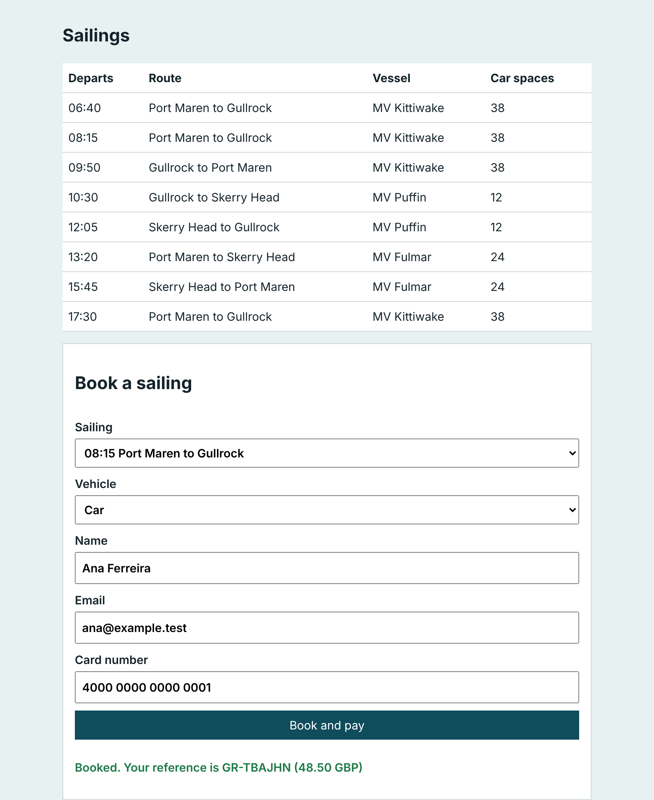

# Meet the harbour

## The problem

You cannot judge an AI SRE on a system you have never seen working. Before anything breaks, follow one booking from the booking page to the bookings table, and watch the finished loop handle a fault once.



## Your challenge

1. Book the 08:15 Port Maren to Gullrock sailing with a car on http://localhost:8000.
2. In HyperDX, find the `POST /api/bookings` trace that made your booking.
3. Fill in `answers.md` in this folder:

```
Booking reference: GR-XXXXXX
Trace id: 32 lower-case hex characters from HyperDX
```

4. Run the finished loop: `bun run demo bad-release`, `bun run approve --yes`, `bun run demo finish`.

## Done when

- `answers.md` names a booking reference and a trace id.
- The booking is a row in the bookings table.
- The trace is the `POST /api/bookings` request that made that booking.
- The audit log shows a human approval, then the change, then verified recovery.

```bash
bun run verify meet-the-harbour
```

Expect: `Done. All 4 rules pass.` and a `Progress:` line.

## If you get stuck

| What you see | Fix |
|---|---|
| `FAIL the booking is a row in the bookings table` | Copy the reference exactly as the page showed it, such as `GR-7KQ2MD`. |
| `FAIL the trace exists and is the POST /api/bookings request` | In HyperDX search for the reference, open the trace whose root span is `POST /api/bookings`, and copy the Trace ID, not a Span ID. |
| `FAIL the finished loop ran` | Run the three demo commands in order; `bun run demo finish` waits for verification. |

## Words you will use

- **Trace id**: the id shared by every span of one request; HyperDX shows it on the trace panel.
- **Incident**: a page that harbour-control's detector opens when a signal crosses its bound.
- **Audit log**: the append-only table `sre.incident_events`; every finding, proposal, approval and run is a row.
