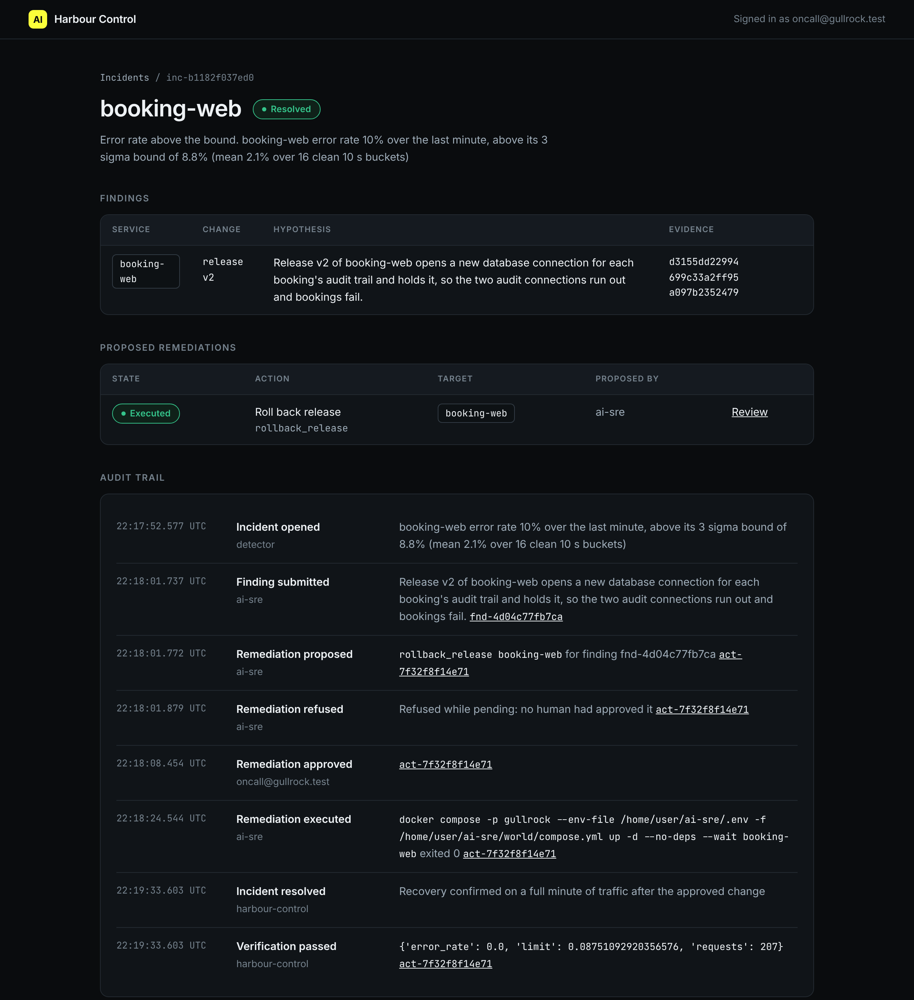
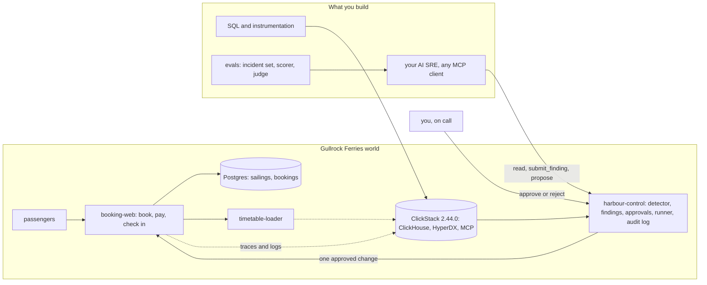

# AI SRE: an incident partner that proves its cause and asks before it acts

You build an AI SRE for Gullrock Ferries, a small island ferry company, on a real observability stack. It investigates with read-only tools, names the planted fault with trace ids and a log line a script can look up, proposes exactly one change, waits for a named human, and is scored on past incidents before you trust it.

**Who it is for.** The senior SRE whose director asks which AI SRE to buy, the developer just added to the on-call rota who has never opened a trace, and the platform lead who must say what an agent may change. All three finish the same flow.

**What you leave with.** A public repo with your AI SRE's scorecard on recorded incidents, zero actions without approval, a prompt injection refused, and a judge you checked against your own labels.

## Run the finished system first

You need Docker (4 GB of memory or more) and Bun 1.4.4. You need no model key: replay mode plays back a recorded AI SRE against your live world, and every claim it makes is checked against this run's telemetry.

```bash
bun install
```

Expect: `bun install` ends with no errors.

```bash
bun run world
```

Expect: `The world is up: every service is healthy.`

```bash
bun run demo bad-release
```

Expect: `Waiting for a human: approve at http://localhost:8090/actions/...`, after the AI SRE's tool calls and one `refused` line for `execute_remediation`.

```bash
bun run approve --yes
```

Expect: `Approved act-... as oncall@gullrock.test. Now run bun run demo finish.`

```bash
bun run demo finish
```

Expect: `Resolved: the change was approved by a human, ran once, and recovery was verified.`



Open http://localhost:8000 for the booking site, http://localhost:8080 for HyperDX, and http://localhost:8090 for Harbour Control. Logins are in `.env`, which `bun run world` writes for you.



## How the course works

Start in [00-orientation](00-orientation/README.md). Each part in `parts/` opens with a real problem and a diagram; each step has a challenge, a Done when list, and one command, `bun run verify <step-name>`, which prints what passed, what failed and what to try next. `bun run verify part <part-name>` checks a whole part. The rules every course repo follows are in [STANDARD.md](STANDARD.md), and [PARTS.md](PARTS.md) maps every part and step.

| Part | What you do | Steps | Minutes |
|---|---|---|---|
| [Orientation](00-orientation/README.md) | Start the world, follow one booking, run the finished loop | 1 | 20 |
| [See every signal](parts/01-see-every-signal/README.md) | Query the services, tag every span with its release, add a span, keep emails out | 4 | 70 |
| [Know when it is broken](parts/02-know-when-it-is-broken/README.md) | Error rate, 3 sigma, burn rate, fewer pages | 4 | 70 |
| [Look without touching](parts/03-look-without-touching/README.md) | Read-only MCP, find the new pattern, the slowest trace, the release | 4 | 70 |
| [Say what broke and prove it](parts/04-say-what-broke/README.md) | A grounded finding, a refused guess, distractors ruled out | 3 | 55 |
| [Ask before you act](parts/05-ask-before-you-act/README.md) | Propose, refuse, approve, roll back, edit the wrong fix, add a config rollback | 6 | 100 |
| [Write it down without blame](parts/06-write-it-down/README.md) | Timeline from the audit log, the postmortem, action items | 3 | 50 |
| [Prove the AI SRE is right](parts/07-prove-the-ai-sre-right/README.md) | Incident set, scorer, judge check, injection, prompt gate | 5 | 100 |

`schedules.toml` maps the parts onto one day, four evenings or four weeks.

## The project

You ship a public repo whose README opens with a scorecard the scorer writes: for each incident, the right cause, grounded trace ids, no distractor blamed, zero unapproved actions. It holds `evals/agent.toml` (the command that runs your AI SRE, in any framework), one incident you designed, the postmortem for a hidden incident, and your action list with its test. In a cohort, the graded work is your finding and proposal on a hidden incident, the postmortem and your eval report, all read by scripts.

## Models

`config/models.ts` is the only file that names a model. Code asks for a role: `fast`, `smart` or `judge`. `LLM_PROVIDER` in `.env` picks `replay` (the default, no key), `anthropic`, `openrouter`, `openai` or `ollama`; put the one key it needs in `.env`, never on a command line, and run `bun run models` to check it.

## Read before you start

1. Alex Palcuie (Anthropic), talk on Claude for SRE incidents, QCon London: https://infoq.com/presentations/claude-sre-incidents. Why a confident cause is not a proven cause.
2. Cloudflare, the 18 November 2025 outage postmortem: https://blog.cloudflare.com/18-november-2025-outage/. One real incident end to end, in a ClickHouse world.
3. Benjamin Barton (Datadog), how Datadog evaluates its SRE agent: https://datadoghq.com/blog/engineering/bits-ai-eval-platform. Where this course ends: an AI SRE with a score.
