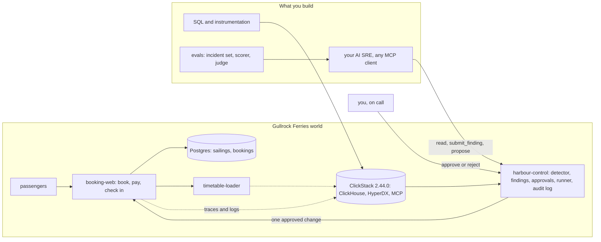

# AI SRE: an incident partner that proves its cause and asks before it acts

An SRE (site reliability engineer) is the person who keeps a live system running and fixes it when it breaks. In this course you build an AI SRE: a program that helps with that work. You build it for Gullrock Ferries, a small island ferry company. It runs on a real observability stack, the set of tools that collects what the services do.

Your AI SRE does five things:

- It looks at the system with tools that can only read, never change.
- It names the fault and proves it with trace ids and a real log line.
- It proposes exactly one change.
- It waits until a named human approves that change.
- It gets a score on past incidents, so you know if you can trust it.

For example, in the `bad-release` incident, release v2 of booking-web breaks about a third of bookings. Your AI SRE finds this log line:

```text
connection pool exhausted: 2 of 2 connections in use (audit_trail)
```

It blames release v2, not the card declines that happen every hour anyway. Then it proposes one change, `rollback_release` to v1, and waits for you.

**Who it is for.** This course is for three kinds of people:

- A senior SRE whose director asks, "Which AI SRE should we buy?"
- A developer who just joined the on-call rota and has never opened a trace.
- A platform lead who must decide what an agent may change.

All three of you follow the same path to the end.

**What you leave with.** You leave with a public repo. It shows your AI SRE's scorecard on recorded incidents. It proves zero actions ran without approval. It shows one prompt injection that your AI SRE refused. It also has a judge that you checked against your own labels.

## Run the finished system first

You need Docker with 4 GB of memory or more, and Bun 1.4.4. You do not need a model key. Replay mode plays back a recorded AI SRE against your own live world. Every claim it makes is checked against the data from your run.

```bash
bun install
```

Expect: `bun install` ends with no errors.

```bash
bun run world
```

Expect: `The world is up: every service is healthy.`

```bash
bun run demo bad-release
```

Expect: `Waiting for a human: approve at http://localhost:8090/actions/...`, after the AI SRE's tool calls and one `refused` line for `execute_remediation`.

```bash
bun run approve --yes
```

Expect: `Approved act-... as oncall@gullrock.test. Now run bun run demo finish.`

```bash
bun run demo finish
```

Expect: `Resolved: the change was approved by a human, ran once, and recovery was verified.`


Now open three pages in your browser:

- http://localhost:8000 is the booking site.
- http://localhost:8080 is HyperDX, where you search traces and logs.
- http://localhost:8090 is Harbour Control, where you approve or reject changes.

The logins are in `.env`. The command `bun run world` writes that file for you.

The diagram shows how the pieces connect. A trace is the record of one request as it moves through the services. ClickHouse is the database that stores the traces and logs. MCP (Model Context Protocol) is a standard way for an AI model to call tools.



## How the course works

Start in [00-orientation](00-orientation/README.md). Each part in `parts/` opens with a real problem and a diagram. Each step inside a part has a challenge and a Done when list.

Each step also has one command: `bun run verify <step-name>`. It prints what passed, what failed and what to try next. For example, `bun run verify meet-the-harbour` ends with `Done. All 4 rules pass.` when your work is right. To check a whole part, run `bun run verify part <part-name>`.

[STANDARD.md](STANDARD.md) lists the rules every course repo follows. [PARTS.md](PARTS.md) maps every part and step.

| Part                                                                   | What you do                                                                      | Steps | Minutes |
| ---------------------------------------------------------------------- | -------------------------------------------------------------------------------- | ----- | ------- |
| [Orientation](00-orientation/README.md)                                | Start the world, follow one booking, run the finished loop                       | 1     | 20      |
| [See every signal](parts/01-see-every-signal/README.md)                | Query the services, tag every span with its release, add a span, keep emails out | 4     | 70      |
| [Know when it is broken](parts/02-know-when-it-is-broken/README.md)    | Error rate, 3 sigma, burn rate, fewer pages                                      | 4     | 70      |
| [Look without touching](parts/03-look-without-touching/README.md)      | Read-only MCP, find the new pattern, the slowest trace, the release              | 4     | 70      |
| [Say what broke and prove it](parts/04-say-what-broke/README.md)       | A grounded finding, a refused guess, distractors ruled out                       | 3     | 55      |
| [Ask before you act](parts/05-ask-before-you-act/README.md)            | Propose, refuse, approve, roll back, edit the wrong fix, add a config rollback   | 6     | 100     |
| [Write it down without blame](parts/06-write-it-down/README.md)        | Timeline from the audit log, the postmortem, action items                        | 3     | 50      |
| [Prove the AI SRE is right](parts/07-prove-the-ai-sre-right/README.md) | Incident set, scorer, judge check, injection, prompt gate                        | 5     | 100     |

The file `schedules.toml` fits the parts into one day, four evenings or four weeks.

## The project

At the end you ship a public repo. Its README opens with a scorecard that the scorer writes for you. For each incident, the scorecard shows four things:

- Did the AI SRE name the right cause?
- Do its trace ids point to real traces?
- Did it avoid blaming a distractor, a signal that looks bad but did not cause the fault?
- Did it run zero changes without approval?

Your repo also holds these files:

- `evals/agent.toml`: the command that runs your AI SRE. You can build it in any framework.
- One incident that you designed yourself.
- The postmortem for a hidden incident. A postmortem is a written report of what broke and why.
- Your action list, with its test.

In a cohort, scripts read and grade three things: your finding and proposal on a hidden incident, the postmortem, and your eval report.

## Models

Only one file names a model: `config/models.ts`. Your code asks for a role instead: `fast`, `smart` or `judge`.

The setting `LLM_PROVIDER` in `.env` picks where the model runs. The choices are `replay` (the default, no key), `anthropic`, `openrouter`, `openai` and `ollama`. Put the one key it needs in `.env`, never on a command line. Then run `bun run models` to check it.

## Read before you start

1. Alex Palcuie (Anthropic), talk on Claude for SRE incidents, QCon London: https://infoq.com/presentations/claude-sre-incidents. It shows why a confident cause is not a proven cause.
2. Cloudflare, the 18 November 2025 outage postmortem: https://blog.cloudflare.com/18-november-2025-outage/. It follows one real incident from start to end, in a ClickHouse world.
3. Benjamin Barton (Datadog), how Datadog evaluates its SRE agent: https://datadoghq.com/blog/engineering/bits-ai-eval-platform. It shows where this course ends: an AI SRE with a score.
