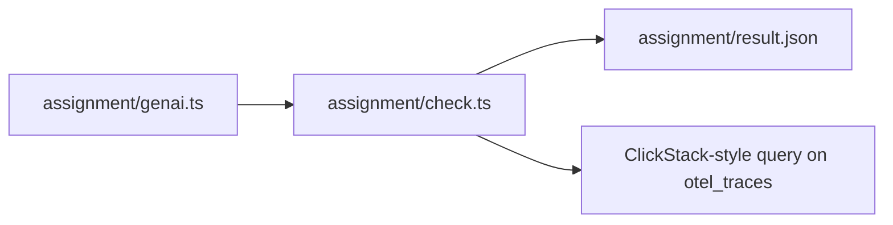

# Assignment: make your AI SRE observable

This is optional in the live session and expected as homework. You work alongside the class while the course teaches the hand-built versions.

## The task

Make your AI SRE observable with the same stack it observes. Fill in `assignment/genai.ts`, the span helper, so each model call becomes an OpenTelemetry GenAI span.

Read `parts/08-do-it-with-the-tools-teams-run/README.md` first. It names every attribute.



## Done when

- Every model call span carries `gen_ai.provider.name`, and every answered call carries `gen_ai.response.model`.
- An answered call records `gen_ai.usage.input_tokens` and `gen_ai.usage.output_tokens`.
- A failed model call sets `error.type`, and an answered call does not.
- A ClickStack query for `gen_ai.provider.name` returns the spans of one incident run.

Run the check.

```bash
bun assignment/check.ts
```

Expect: one `PASS` line per Done-when line, then `All Done-when lines pass. Wrote assignment/result.json.`

The result file holds one `pass` or `fail` per line and the versions it found.

## Rubric

A person reads these three lines.

1. The attribute names follow the convention exactly.
2. `assignment/CHOICE.md` says the conventions are in Development status.
3. `assignment/CHOICE.md` says when Langfuse is worth about 2.3 GiB more memory.

## Hand in

Push a branch named `assignment` and submit its URL. The grader runs the same `bun assignment/check.ts`.

## Look at your spans

You can see real spans in ClickStack. This is optional, and the check does not need it.

```bash
docker compose -f assignment/compose.yml up -d
```

Expect: one container, `clickstack`, starts. Open http://localhost:8080.

```bash
docker compose -f assignment/compose.yml down -v
```

Expect: the container and its volumes are removed.
