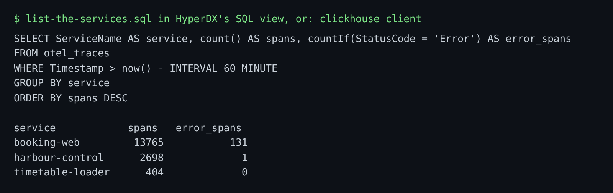

# List the services

## The problem

You are paged at Gullrock Ferries and the first question is simple: which services are running, how busy is each, and which one is failing? If you cannot answer that in one query, every later step is a guess.

ClickStack keeps every span in one ClickHouse table, `otel_traces`. One row is one span: a unit of work such as one HTTP request or one SQL statement.



## Your challenge

Edit `list-the-services.sql` in this folder. Write one SELECT over `otel_traces` that returns, for the last 60 minutes:

| Column        | Meaning                                        |
| ------------- | ---------------------------------------------- |
| `service`     | the service that sent the span (`ServiceName`) |
| `spans`       | how many spans it sent                         |
| `error_spans` | how many of them failed (`StatusCode`)         |

Busiest service first. Try it in HyperDX first: open http://localhost:8080, choose SQL, and run it there.

## Done when

- The file holds one SELECT and it runs.
- It returns the columns `service`, `spans` and `error_spans`, one row per service.
- The busiest service is the first row, and the counts match the telemetry.

```bash
bun run verify list-the-services
```

Expect: `Done. All 7 rules pass.` and a `Progress:` line.

The check runs your query against the live world when it is up. In CI it runs against a recorded morning at Gullrock, played back so it ends at the moment you query it.

## If you get stuck

| What you see                       | Fix                                                                                                                   |
| ---------------------------------- | --------------------------------------------------------------------------------------------------------------------- |
| `FAIL the query runs`              | Paste the query into HyperDX's SQL view; it shows the ClickHouse error in full.                                       |
| `FAIL one row per service`         | Add `GROUP BY service`. Without it you get one row per span.                                                          |
| `FAIL span and error counts match` | Look at a few rows of `StatusCode` first: `SELECT DISTINCT StatusCode FROM otel_traces`. The value is case sensitive. |

## Words you will use

- **Span**: one timed unit of work, such as one request or one SQL statement, with a name, a duration and a status.
- **Trace**: all the spans of one request across every service, linked by one trace id.
- **countIf**: a ClickHouse function that counts only the rows where a condition is true.
