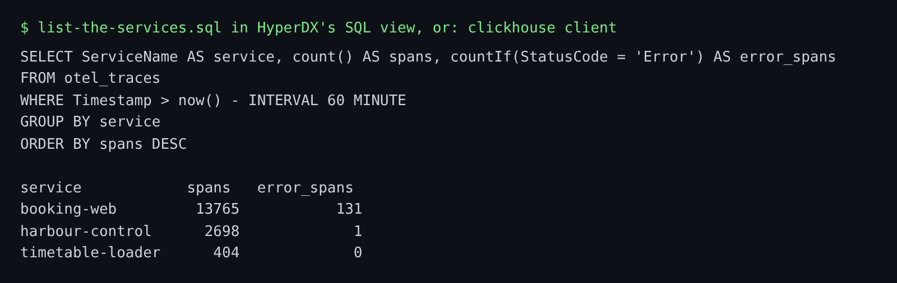

# List the services

## The problem

You get paged. Which services run, how busy is each, and which one fails? One query answers all three. On the recorded bad-release morning, booking-web had 131 failed spans. timetable-loader had none.

## Watch it done

Before, you have no query. After, the query prints one row per service:

```text
service            spans   error_spans
booking-web         7173           131
timetable-loader     196             0
```



## Your turn

Open `list-the-services.sql` in this folder.

1. Write one SELECT over `otel_traces`. One row in that table is one span. Look at the last `60 minutes`.

   Return these columns:

   | Column        | Meaning                                        |
   | ------------- | ---------------------------------------------- |
   | `service`     | the service that sent the span (`ServiceName`) |
   | `spans`       | how many spans it sent                         |
   | `error_spans` | how many of them failed (`StatusCode`)         |

   Put the busiest service first.

2. Open http://localhost:8080 in your browser. This is HyperDX, the web screen of ClickStack. Choose SQL and run your query there.

   Expect: the same three columns as the table above.

## Do it on your work

Run the same query on your own service's telemetry. Count spans and failed spans per service for the last hour. Good looks like this: the busiest service is first, and its error count matches what you see in HyperDX.

## Done when

- The file holds one SELECT, and it runs.
- It returns the columns `service`, `spans` and `error_spans`, with one row per service.
- The busiest service is the first row, and the counts match the telemetry.

```bash
bun run verify list-the-services
```

Expect: `Done. All 7 rules pass.` and a `Progress:` line.

When the world is up, the check runs your query against the live world. In CI, it uses a recorded morning at Gullrock instead. CI is the robot that runs every check when someone pushes code. The recording plays back so that it ends at the moment you query it.

## Solution

The finished query is in `solution/list-the-services.sql`.

## If you get stuck

Each FAIL line tells you what to try next. For example, a query that writes `'ERROR'` in capital letters gets this:

```text
  FAIL  span and error counts match the telemetry
        Try next: count spans with count() and errors with countIf(StatusCode = 'Error'); the value is case sensitive, so look at one row first
```

| What you see                       | Fix                                                                                                                   |
| ---------------------------------- | --------------------------------------------------------------------------------------------------------------------- |
| `FAIL the query runs`              | Paste the query into the SQL view of HyperDX. It shows the full ClickHouse error.                                     |
| `FAIL one row per service`         | Add `GROUP BY` `service`. Without it, you get one row for each span.                                                  |
| `FAIL span and error counts match` | Look at the values first: `SELECT DISTINCT` `StatusCode FROM` `otel_traces` prints `Unset` and `Error`. Case matters. |

## Words you will use

- **Span**: one piece of timed work, such as one request or one SQL statement. It has a name, a duration and a status.
- **Trace**: all the spans of one request across every service. One trace id links them.
- **countIf**: a ClickHouse function. It counts only the rows where a condition is true.
