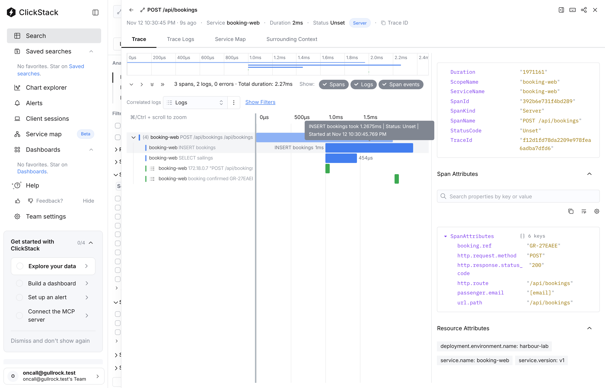

# Tag the release

## The problem

Booking errors go up. Which release changed? A span can answer that only if it names its release. Right now, booking-web spans name the service but not the release.

## Watch it done

Every booking-web span names its release. So you can count spans per release:

```text
service.version   spans
v1                 2268
v2                 4905
```

Without the release on each span, you see one big number. You cannot tell that the new release is different.



## Your turn

Open `telemetry.ts` in this folder. It uses OpenTelemetry, the open standard that services use to send spans and logs.

1. Find the function `bookingResource`. It builds the resource: the attributes that every span and log line from booking-web carries. An attribute is a name with a value, such as `service.name` = `booking-web`.
2. Add the standard attribute `service.version`. Set it to the release that is running.
3. Read that release from `env.BOOKING_RELEASE`. `env` holds the settings that booking-web reads when it starts. Do not write a fixed value.
4. To see your version live, run `bun run world try tag-the-release`. Then book a sailing on http://localhost:8000 and open the span in HyperDX.

   Expect: the span shows `service.version` in its resource attributes.

   `bun run world try off` puts the finished version back.

## Do it on your work

Add the same attribute to one service you run. Read its release from your own deploy setting. Good looks like this: every span from that service names its release, so you can count spans per release.

## Done when

- booking-web starts with your `telemetry.ts`, and its spans reach the collector. The collector is the program that receives spans and stores them.
- Every span carries the resource attribute `service.version`.
- It names the release that is running, whatever that release is called.
- `service.name` is still `booking-web`.

```bash
bun run verify tag-the-release
```

Expect: `Done. All 5 rules pass.` and a `Progress:` line.

## Solution

The finished file is in `solution/telemetry.ts`.

## If you get stuck

The check starts booking-web as release `v7`, a name you cannot guess. For example, if your code always writes `v1`, the check prints:

```text
  FAIL  service.version names the release that is running (v7 in this check)
        Try next: read the release from env.BOOKING_RELEASE; a fixed value like v1 is wrong as soon as v2 ships
```

| What you see                                                     | Fix                                                                                                                                                             |
| ---------------------------------------------------------------- | --------------------------------------------------------------------------------------------------------------------------------------------------------------- |
| `FAIL every span carries the resource attribute service.version` | The key is exactly `service.version`. OpenTelemetry defines this name.                                                                                          |
| `FAIL service.version names the release that is running`         | Read the value from `env.BOOKING_RELEASE`. Do not write a fixed value.                                                                                          |
| `FAIL booking-web starts with your telemetry.ts`                 | Check that `telemetry.ts` is in `problem/`. Then run the command in the Try next line and read the error. Port 8100 keeps it apart from the world on port 8000. |

## Words you will use

- **Resource**: the attributes that describe the program that sends telemetry. They go on everything it sends.
- **Semantic conventions**: the attribute names that OpenTelemetry defines, such as `service.name` and `service.version`. Every tool reads them the same way.
- **Release**: one deployed version of a service.
