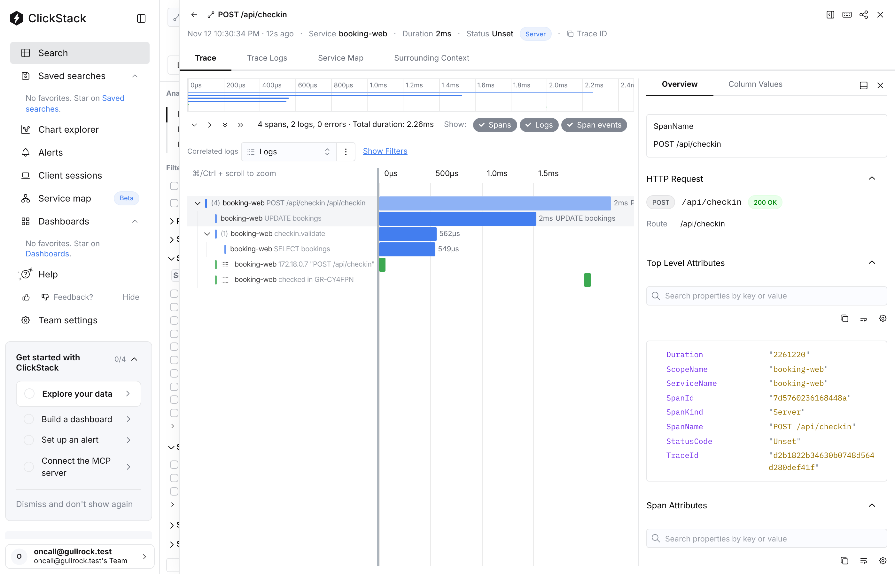

# Add the check-in span

## The problem

Cars queue on the quay at Port Maren while staff check bookings in. When check-in is slow, the trace shows the request and its SQL, but not the step that decides whether a booking may board. Nobody can see which booking was checked, or how long the decision took.



## Your challenge

Edit `checkin.ts` in this folder. Wrap the work in `validateCheckin` in a span named `checkin.validate`, give it the attribute `booking.ref`, and make sure it ends. It must be a child of the `POST /api/checkin` request span, so it shows inside the same trace.

Keep the return values as they are: `null` when the booking may check in, a sentence when it may not.

`bun run world try add-the-checkin-span` runs your version live.

## Done when

- Check-in still works, and an unknown reference is refused.
- A span named `checkin.validate` is exported, with `booking.ref` set to the reference.
- Its parent is the `POST /api/checkin` span of the same trace.

```bash
bun run verify add-the-checkin-span
```

Expect: `Done. All 5 rules pass.` and a `Progress:` line.

## If you get stuck

| What you see | Fix |
|---|---|
| `FAIL a span named checkin.validate is exported` | A span is exported only when it ends. Call `span.end()` in a `finally` block. |
| `FAIL the span sits inside the POST /api/checkin request` | Use `tracer.startActiveSpan`, which starts from the active context. A span started from `ROOT_CONTEXT` begins a new trace. |

## Words you will use

- **Manual span**: a span your own code starts and ends, around work no library measures for you.
- **Parent span**: the span that was active when another started; the waterfall draws the child inside it.
- **Active context**: where OpenTelemetry keeps the span that is running now, so new spans can find their parent.
