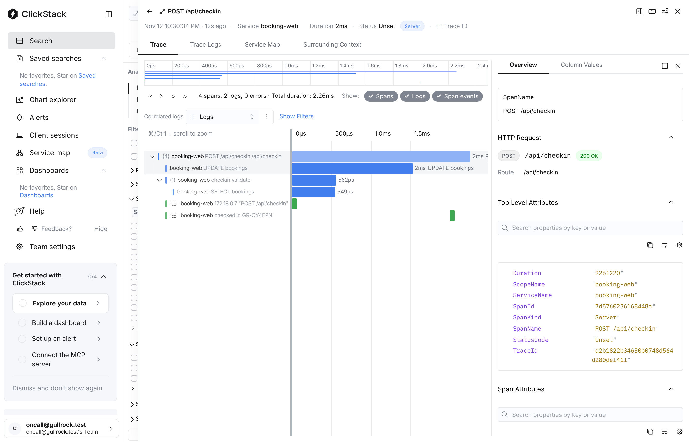

# Add the check-in span

## The problem

Cars queue on the quay at Port Maren. Staff check each booking in. On the recorded bad-release morning, one check took 554343 nanoseconds. The trace showed the request and its SQL, but not the decision.

## Watch it done

A manual span is a span your own code starts and ends. Once it is in place, the telemetry holds rows like these. The duration is in nanoseconds, so 554343 is about half a millisecond.

```text
SpanName           booking.ref   Duration
checkin.validate   GR-PP87NP       554343
checkin.validate   GR-MBMWF4      1525816
```



## Your turn

Open `checkin.ts` in this folder.

1. In `validateCheckin`, put its work inside a span named `checkin.validate`.
2. Give the span the attribute `booking.ref`, set to the booking reference.
3. Make sure the span ends, on every path. A span is sent only when it ends.
4. Keep the return values as they are. Return `null` when the booking may check in. Return a sentence when it may not.
5. The span must be a child of the `POST /api/checkin` request span. Then it shows inside the same trace.
6. Run `bun run world try add-the-checkin-span` to see your version live.

   Expect: the new span appears inside the check-in waterfall in HyperDX.

## Do it on your work

Add one manual span around one slow step in a service you run. Name it for the decision it makes. Good looks like this: the span shows in the same trace as its request, with the id you chose.

## Done when

- Check-in still works, and an unknown reference is refused.
- A span named `checkin.validate` is exported, with `booking.ref` set to the reference.
- Its parent is the `POST /api/checkin` span of the same trace.

```bash
bun run verify add-the-checkin-span
```

Expect: `Done. All 5 rules pass.` and a `Progress:` line.

## Solution

The finished file is in `solution/checkin.ts`.

## If you get stuck

A common mistake is a span that never ends. For example, the check prints this for that mistake:

```text
  FAIL  a span named checkin.validate is exported
        Try next: wrap the lookup in tracer.startActiveSpan("checkin.validate", ...) and call span.end() in a finally block
```

| What you see                                              | Fix                                                                                                                     |
| --------------------------------------------------------- | ----------------------------------------------------------------------------------------------------------------------- |
| `FAIL a span named checkin.validate is exported`          | A span is sent only when it ends. Call `span.end()` in a `finally` block, so it ends on every path.                     |
| `FAIL the span sits inside the POST /api/checkin request` | Use `tracer.startActiveSpan`. It starts from the active context. A span started from `ROOT_CONTEXT` begins a new trace. |

## Words you will use

- **Manual span**: a span that your own code starts and ends. You use it for work that no library measures for you.
- **Parent span**: the span that was running when another span started. The waterfall draws the child inside it.
- **Active context**: the place where OpenTelemetry keeps the span that is running now. New spans look there to find their parent.
