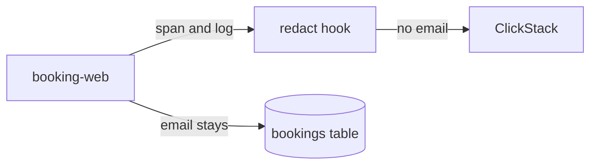

# Hide the email

## The problem

booking-web writes each passenger's email into a span attribute called `passenger.email`. It also writes the email into a log line.

Telemetry is copied to many places: to dashboards, to vendors, and now to an AI SRE that reads it. An email address is personal data, because it identifies a person. A passenger's email belongs in the bookings table, and nowhere else.

For example, booking-web writes this log line for every booking, with the passenger's email at the end. After your fix, the email is replaced. This line is from the recorded bad-release morning:

```text
booking confirmed GR-BNXNJ9 on the 08:15 port-maren to gullrock for [email]
```

The booking reference and the sailing stay. Only the email is gone.



## Your challenge

Open `redact.ts` in this folder. booking-web calls both of its functions on every span and log record, right before it sends them:

- `redactBody` gets a log line. It returns the line with every email address replaced by `[email]`.
- `redactAttributes` gets the attributes of a span or log record. It returns them with every email inside a string value replaced.

Change only the email text. The span must still say which booking and which route it was.

## Done when

- booking-web takes bookings with your `redact.ts`.
- No span attribute, log line or log attribute holds an email address.
- Spans still carry `booking.ref` and `http.route`.

```bash
bun run verify hide-the-email
```

Expect: `Done. All 4 rules pass.` and a `Progress:` line.

## If you get stuck

A common mistake is to clean the spans and forget the log line. For example, the check prints:

```text
  FAIL  no log line or log attribute holds an email address
        Try next: redactBody runs on every log line; the booking confirmed line names the passenger's email
```

| What you see                                               | Fix                                                                               |
| ---------------------------------------------------------- | --------------------------------------------------------------------------------- |
| `FAIL no log line or log attribute holds an email address` | The "booking confirmed" line names the passenger. `redactBody` must clean it too. |
| `FAIL spans still say what happened`                       | Return every attribute. Replace only the email inside the value; keep the rest.   |

## Words you will use

- **Personal data**: anything that identifies a person, such as an email address.
- **Redact**: replace private text with a placeholder, such as `[email]`, before it leaves the service.
- **Exporter**: the part of OpenTelemetry that sends finished spans and logs to the collector.
