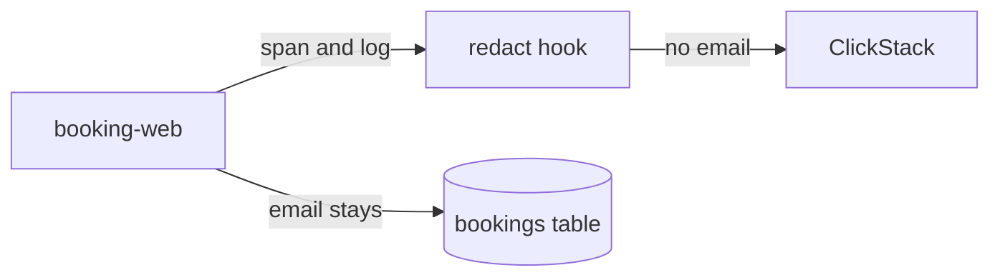

# Hide the email

## The problem

booking-web writes each passenger's email into a span attribute and a log line. Telemetry goes to dashboards, vendors and an AI SRE. An email is personal data. It belongs in the bookings table, and nowhere else.

## Watch it done

For example, booking-web writes this log line for every booking. After your fix, the email is replaced. This line is from the recorded bad-release morning:

```text
booking confirmed GR-BNXNJ9 on the 08:15 port-maren to gullrock for [email]
```

The booking reference and the sailing stay. Only the email is gone.



## Your turn

Open `redact.ts` in this folder. booking-web calls both of its functions on every span and log record, right before it sends them.

1. In `redactBody`, replace every email address in the log line with `[email]`. This function gets a log line and returns it.
2. In `redactAttributes`, replace every email inside a string value. This function gets the attributes of a span or log record and returns them.
3. Change only the email text. Keep every other attribute as it was.
4. Check that spans still carry `booking.ref` and `http.route`.
5. Run `bun run verify hide-the-email` to see the result.

   Expect: `Done. All 4 rules pass.` and a `Progress:` line.

## Do it on your work

Find one log line from your own service that holds an email. Replace the email with `[email]` in that line. Good looks like this: the line still names the booking or request, and no email address is left in it.

## Done when

- booking-web takes bookings with your `redact.ts`.
- No span attribute, log line or log attribute holds an email address.
- Spans still carry `booking.ref` and `http.route`.

```bash
bun run verify hide-the-email
```

Expect: `Done. All 4 rules pass.` and a `Progress:` line.

## Solution

The finished file is in `solution/redact.ts`.

## If you get stuck

A common mistake is to clean the spans and forget the log line. For example, the check prints:

```text
  FAIL  no log line or log attribute holds an email address
        Try next: redactBody runs on every log line; the booking confirmed line names the passenger's email
```

| What you see                                               | Fix                                                                               |
| ---------------------------------------------------------- | --------------------------------------------------------------------------------- |
| `FAIL no log line or log attribute holds an email address` | The "booking confirmed" line names the passenger. `redactBody` must clean it too. |
| `FAIL spans still say what happened`                       | Return every attribute. Replace only the email inside the value. Keep the rest.   |

## Words you will use

- **Personal data**: anything that identifies a person, such as an email address.
- **Redact**: replace private text with a placeholder, such as `[email]`, before it leaves the service.
- **Exporter**: the part of OpenTelemetry that sends finished spans and logs to the collector.
