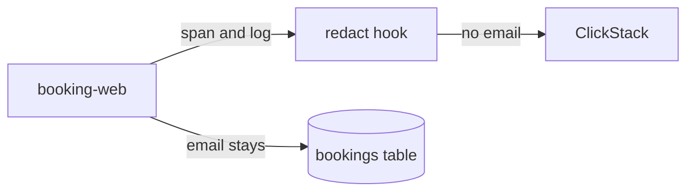

# Hide the email

## The problem

booking-web writes each passenger's email into a span attribute and a log line. Telemetry is copied widely: to dashboards, to vendors, and now to an AI SRE that reads it. A passenger's email belongs in the bookings table, and nowhere else.



## Your challenge

Edit `redact.ts` in this folder. booking-web calls both functions on every span and log record just before export:

- `redactBody` gets a log line and returns it with every email address replaced by `[email]`.
- `redactAttributes` gets the attributes of a span or log record and returns them with every email inside a string value replaced.

Change only the email text. The span must still say which booking and which route it was.

## Done when

- booking-web takes bookings with your `redact.ts`.
- No span attribute, log line or log attribute holds an email address.
- Spans still carry `booking.ref` and `http.route`.

```bash
bun run verify hide-the-email
```

Expect: `Done. All 4 rules pass.` and a `Progress:` line.

## If you get stuck

| What you see | Fix |
|---|---|
| `FAIL no log line or log attribute holds an email address` | The "booking confirmed" line names the passenger. `redactBody` must clean it too. |
| `FAIL spans still say what happened` | Return every attribute; replace only the email inside the value. |

## Words you will use

- **Personal data**: anything that identifies a person, such as an email address.
- **Redact**: replace sensitive text with a placeholder before it leaves the service.
- **Exporter**: the part of OpenTelemetry that sends finished spans and logs to the collector.
