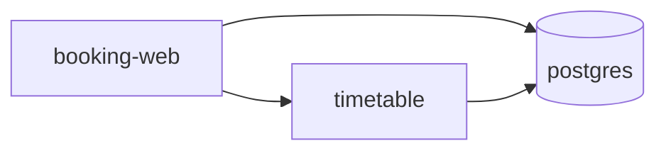

# Map the topology

## The problem

When one service fails, you need to know who calls it and who it calls. A list of spans does not show that. A map does. Topology means the map of which service talks to which. For example, a booking page asks the timetable, and the timetable asks the database.



## Watch it done

The file `calls.csv` has one row per span. It shows the service of the parent span and the service of the child. A row where both are the same is work inside one service, so it is not an edge. Every other row is one edge.

## Your challenge

Open `topology.txt` in this folder.

1. Read `calls.csv`.
2. Skip each row where the parent and the child are the same service.
3. Write each different pair once, as `- parent -> child`.
4. Write the one service that nothing calls after `Entry:`.

```bash
bun run verify map-the-topology
```

Expect: `Done. All 4 rules pass.` and a `Progress:` line.

## Do it on your work

Pull the parent and child service of each span from your own traces and build the same file. Good looks like this: a new person can find the first service to look at when users report a problem.

## Done when

- Every call between two services is an edge.
- No edge is invented, and no service calls itself.
- The entry service is named.

## If you get stuck

| What you see                                      | Fix                                                               |
| ------------------------------------------------- | ----------------------------------------------------------------- |
| `FAIL every service call in calls.csv is an edge` | Each different pair needs one line, even if it shows up often.    |
| `FAIL no edge is invented`                        | Delete a line that has no row, or that joins a service to itself. |

## Words you will use

- **Topology**: the map of which service calls which.
- **Edge**: one line on the map, from a caller to a callee.
- **Entry**: the service that users reach first.
