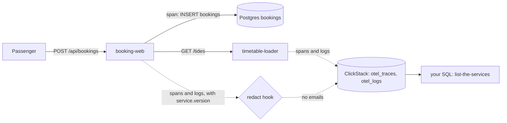

# See every signal

## After this part you can

Find the failing service with one query. Tag every span with its release. Keep emails out of telemetry.

## You leave with

A query in `list-the-services.sql`. Fixes in `telemetry.ts`, `checkin.ts` and `redact.ts`. A map of the services in `topology.txt`.

## The problem

Gullrock Ferries sells ferry tickets on a website. A booking can fail. The person on call must follow that one booking from the click to the database.

Services send telemetry: spans and logs about their own work. Every span must name its release. Without that, nobody can answer "what changed?"

For example, on the recorded bad-release morning, the new release had 131 errors. The old one had none. Only the release told them apart.



The dotted lines are telemetry. ClickStack stores it in two tables, `otel_traces` and `otel_logs`.

Microsoft's AIOpsLab test plants 31 kinds of fault. An agent can tell them apart only when every signal names its service, release and request. See github.com/microsoft/AIOpsLab.

## Steps

You do five steps. Each one adds one piece to the picture above.

| Step                   | Minutes | You produce                                 | The check reads                                                           |
| ---------------------- | ------- | ------------------------------------------- | ------------------------------------------------------------------------- |
| `list-the-services`    | 15      | `list-the-services.sql`                     | your query's rows against the reference rows, live or recorded            |
| `tag-the-release`      | 20      | `telemetry.ts` with `service.version`       | every span booking-web exports under a release name you cannot guess      |
| `add-the-checkin-span` | 20      | `checkin.ts` with a `checkin.validate` span | the check-in trace: span name, `booking.ref`, parent span                 |
| `hide-the-email`       | 15      | `redact.ts`                                 | every exported span attribute and log line, scanned for email addresses   |
| `map-the-topology`     | 15      | `topology.txt`: the edges between services  | every edge derived from `calls.csv`, none invented, and the entry service |

## Walkthrough

Start the world once. The world is the Gullrock services and their database, running on your machine.

```bash
bun run world
```

Expect: `The world is up: every service is healthy.`

Work through the steps in order. Each step folder keeps your starter files in `problem/`. When you finish a step, run its check.

First, write one query that lists the services.

```bash
bun run verify list-the-services
```

Expect: `Done. All 7 rules pass.` once your query is written.

Next, put the release on every span.

```bash
bun run verify tag-the-release
```

Expect: `Done. All 5 rules pass.` once `service.version` is on every span.

Then add your own span to check-in.

```bash
bun run verify add-the-checkin-span
```

Expect: `Done. All 5 rules pass.` once the span is inside the check-in request.

Last, keep passenger emails out of the telemetry.

```bash
bun run verify hide-the-email
```

Expect: `Done. All 4 rules pass.` once no email leaves booking-web.

This command runs the checks of every step in the part at once.

```bash
bun run verify part see-every-signal
```

Expect: `Part see-every-signal is done: 4/4 steps pass.`

## Watch and read

The course team has not added picks for this part yet.

| Kind | Title | Author | Why | Link |
| ---- | ----- | ------ | --- | ---- |

## Project

Pick one service you run. Add its release to every span. Then write one query that counts its spans and failed spans per release. Save the query and a short note. The note names the release that failed most, and what you would check first.
