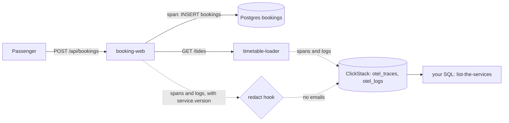

# See every signal

## The problem

At Gullrock Ferries a booking starts as a click on the booking page, crosses booking-web and timetable-loader, and ends as a row in Postgres. When it fails, on-call needs one trace from the click to the database, and every span in it must say which release served it. Without that, "what changed?" has no answer, and neither a human nor an AI SRE can prove a cause.

Why it matters: Microsoft's AIOpsLab benchmark for AI operations agents plants 31 kinds of fault, from a killed pod to a misconfigured app (31 fault folders under `aiopslab/orchestrator/problems` in github.com/microsoft/AIOpsLab, read on the build date). An agent can only tell them apart when every signal names its service, its release and its request.



## Steps

| Step | Minutes | You produce | The check reads |
|---|---|---|---|
| `list-the-services` | 15 | `list-the-services.sql` | your query's rows against the reference rows, live or recorded |
| `tag-the-release` | 20 | `telemetry.ts` with `service.version` | every span booking-web exports under a release name you cannot guess |
| `add-the-checkin-span` | 20 | `checkin.ts` with a `checkin.validate` span | the check-in trace: span name, `booking.ref`, parent span |
| `hide-the-email` | 15 | `redact.ts` | every exported span attribute and log line, scanned for email addresses |

## Walkthrough

Start the world once, then work through the steps in order. Each step folder holds your starter in `problem/`.

```bash
bun run world
```

Expect: `The world is up: every service is healthy.`

```bash
bun run verify list-the-services
```

Expect: `Done. All 7 rules pass.` once your query is written.

```bash
bun run verify tag-the-release
```

Expect: `Done. All 5 rules pass.` once `service.version` is on every span.

```bash
bun run verify add-the-checkin-span
```

Expect: `Done. All 5 rules pass.` once the span is inside the check-in request.

```bash
bun run verify hide-the-email
```

Expect: `Done. All 4 rules pass.` once no email leaves booking-web.

```bash
bun run verify part see-every-signal
```

Expect: `Part see-every-signal is done: 4/4 steps pass.`
