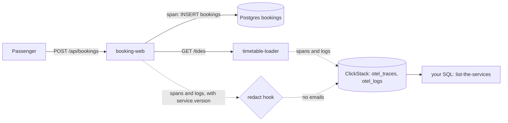

# See every signal

## The problem

Gullrock Ferries sells ferry tickets on a website. A booking starts when a passenger clicks on the booking page. The request goes through two services, booking-web and timetable-loader. It ends as a new row in the Postgres database.

Sometimes a booking fails. Then the person on call must follow that one booking from the click to the database. The person on call is the engineer whose job right now is to fix problems.

To follow a booking, you need a few words:

- A **span** is a record of one piece of timed work. For example, one HTTP request is one span, and one SQL statement is another.
- A **trace** is all the spans of one request, across every service. They share one trace id.
- An **attribute** is a name and a value on a span, such as `service.version` = `v2`.
- A **release** is one deployed version of a service, such as `v1` or `v2`.

Every span must say which release served it. Without that, nobody can answer the question "what changed?". Not a person, and not an AI SRE. An SRE (site reliability engineer) keeps services running. An AI SRE is a program that helps with that job.

For example, here is the recorded bad-release morning at Gullrock. It counts the `POST /api/bookings` spans of booking-web for each release:

```text
service.version   requests   errors
v1                     304        0
v2                     607      131
```

Release `v1` has no errors. Release `v2` has 131. This table exists only because every span carries `service.version`. Without that attribute, you see 131 errors and no cause.

Why it matters: Microsoft built a test for AI operations agents called AIOpsLab. It plants 31 kinds of fault. They range from a killed pod (a stopped container) to an app with a wrong setting. We counted 31 fault folders under `aiopslab/orchestrator/problems` in github.com/microsoft/AIOpsLab on the build date. An agent can tell these faults apart only when every signal names its service, its release and its request.

This picture shows where the signals go. The dotted lines are telemetry: the spans and logs that each service sends about its own work. ClickStack stores them in two tables, `otel_traces` and `otel_logs`.



## Steps

You do four steps. Each one adds one piece to the picture above.

| Step                   | Minutes | You produce                                 | The check reads                                                         |
| ---------------------- | ------- | ------------------------------------------- | ----------------------------------------------------------------------- |
| `list-the-services`    | 15      | `list-the-services.sql`                     | your query's rows against the reference rows, live or recorded          |
| `tag-the-release`      | 20      | `telemetry.ts` with `service.version`       | every span booking-web exports under a release name you cannot guess    |
| `add-the-checkin-span` | 20      | `checkin.ts` with a `checkin.validate` span | the check-in trace: span name, `booking.ref`, parent span               |
| `hide-the-email`       | 15      | `redact.ts`                                 | every exported span attribute and log line, scanned for email addresses |

## Walkthrough

Start the world once. The world is the Gullrock services and their database, running on your machine.

```bash
bun run world
```

Expect: `The world is up: every service is healthy.`

Now work through the steps in order. Each step folder keeps your starter files in `problem/`. When you finish a step, run its check.

First, write one query that lists the services.

```bash
bun run verify list-the-services
```

Expect: `Done. All 7 rules pass.` once your query is written.

Next, put the release on every span.

```bash
bun run verify tag-the-release
```

Expect: `Done. All 5 rules pass.` once `service.version` is on every span.

Then add your own span to check-in.

```bash
bun run verify add-the-checkin-span
```

Expect: `Done. All 5 rules pass.` once the span is inside the check-in request.

Last, keep passenger emails out of the telemetry.

```bash
bun run verify hide-the-email
```

Expect: `Done. All 4 rules pass.` once no email leaves booking-web.

This command runs all four checks at once.

```bash
bun run verify part see-every-signal
```

Expect: `Part see-every-signal is done: 4/4 steps pass.`
