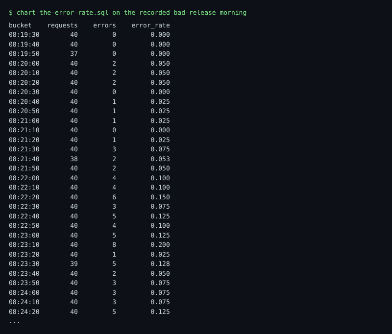

# Chart the error rate

## The problem

A detector needs one number to watch: the error rate of booking-web. A single count of errors is not enough. So divide failed requests by all requests, in short slices of time called buckets.

For example, one 10 second bucket on the bad-release recording has 40 requests and 6 errors, so its error rate is 0.15.

## Watch it done

The new release went out at about 08:19:50. Errors start in the next bucket. Your query gives rows like these:

```text
bucket     requests   errors   error_rate
08:19:40         40        0        0
08:19:50         37        0        0
08:20:00         40        2        0.05
08:20:10         40        2        0.05
08:24:20         40        5        0.125
```

An error rate of 0.05 means 5% of the requests in that bucket failed. The finished query looks like this:



## Your turn

1. Open `chart-the-error-rate.sql` in this folder. Write one SELECT over `otel_traces`. It returns one row per 10 second bucket of the last `15 minutes`. Use these four columns:

   | Column       | Meaning                                                                     |
   | ------------ | --------------------------------------------------------------------------- |
   | `bucket`     | the start of the bucket: `toStartOfInterval(Timestamp, INTERVAL 10 SECOND)` |
   | `requests`   | how many requests booking-web served in it                                  |
   | `errors`     | how many of them failed (`StatusCode = 'Error'`)                            |
   | `error_rate` | `errors / requests`, a fraction between 0 and 1                             |

   Buckets matter. Ten errors in a busy minute is normal. Ten in a quiet minute is a fault.

2. Count only requests. A request is a booking-web span whose `SpanKind` is `Server`. Leave out `GET /health`. That is Docker asking "are you alive?", not a passenger.
3. Put the oldest bucket first.
4. Try it in HyperDX on the live world. Open http://localhost:8080 and choose SQL.

## Do it on your work

Write the same query for one service of your own. Use its name in place of `booking-web`. Good looks like: every `error_rate` is between 0 and 1, and the buckets with errors match what your logs show.

## Done when

- The file holds one SELECT, and it runs.
- It returns `bucket`, `requests`, `errors` and `error_rate`, oldest bucket first.
- Every bucket has the same counts as the reference query, and every rate is between 0 and 1.

```bash
bun run verify chart-the-error-rate
```

Expect: `Done. All 7 rules pass.` and a `Progress:` line.

The check plays the recording back, so `now()` is the end of that morning.

## Solution

The finished query is in `solution/chart-the-error-rate.sql`.

## If you get stuck

A common mistake is to count every span. One booking makes several spans, but only the request fails. So the rate looks several times too small.

| What you see                                                               | Fix                                                                                            |
| -------------------------------------------------------------------------- | ---------------------------------------------------------------------------------------------- |
| `FAIL every error_rate is a fraction`                                      | Do not multiply by 100. The detector in the next step expects 0 to 1.                          |
| `FAIL each bucket counts the failed requests`                              | Use `countIf(StatusCode = 'Error')`. The value is case sensitive.                              |
| `FAIL the oldest bucket comes first`                                       | Add `ORDER BY` `bucket`.                                                                       |
| `FAIL each bucket counts booking-web requests only, without health checks` | Keep only `ServiceName = 'booking-web' AND SpanKind = 'Server' AND SpanName != 'GET /health'`. |

## Words you will use

- **Error rate**: failed requests divided by all requests, in one slice of time.
- **Bucket**: one slice of time. Here every bucket is 10 seconds long.
- **Server span**: the span a service writes when it answers a request. `SpanKind` says `Server`.
