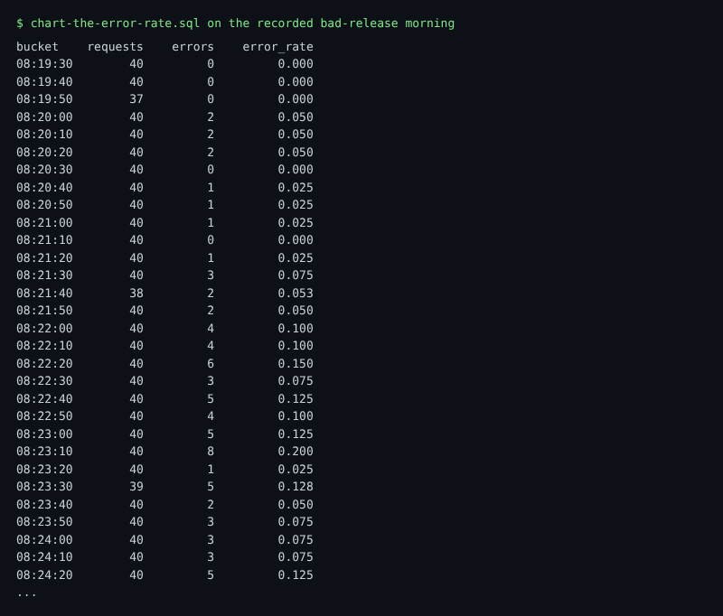

# Chart the error rate

## The problem

A detector needs one number to watch. At Gullrock that number is the error rate of booking-web: failed requests divided by all requests.

One count of errors is not enough. Ten errors in a busy minute is normal. Ten errors in a quiet minute is a fault. So you divide by the number of requests, in short slices of time. Each slice is a bucket of 10 seconds.

For example, here are a few buckets from the recorded bad-release morning. The new release went out at about 08:19:50. Errors start in the next bucket:

```text
bucket     requests   errors   error_rate
08:19:40         40        0        0
08:19:50         37        0        0
08:20:00         40        2        0.05
08:20:10         40        2        0.05
08:24:20         40        5        0.125
```

An error rate of 0.05 means 5% of the requests in that bucket failed.



## Your challenge

Open `chart-the-error-rate.sql` in this folder. Write one SELECT over `otel_traces` that returns one row per 10 second bucket of the last 15 minutes:

| Column       | Meaning                                                                     |
| ------------ | --------------------------------------------------------------------------- |
| `bucket`     | the start of the bucket: `toStartOfInterval(Timestamp, INTERVAL 10 SECOND)` |
| `requests`   | how many requests booking-web served in it                                  |
| `errors`     | how many of them failed (`StatusCode = 'Error'`)                            |
| `error_rate` | `errors / requests`, a fraction between 0 and 1                             |

Count only requests. A request is a booking-web span whose `SpanKind` is `Server`. Leave out `GET /health`: that is Docker asking "are you alive?", not a passenger. Put the oldest bucket first.

You can try the query in HyperDX on the live world: open http://localhost:8080 and choose SQL.

## Done when

- The file holds one SELECT, and it runs.
- It returns `bucket`, `requests`, `errors` and `error_rate`, oldest bucket first.
- Every bucket has the same counts as the reference query, and every rate is between 0 and 1.

```bash
bun run verify chart-the-error-rate
```

Expect: `Done. All 7 rules pass.` and a `Progress:` line.

The check always runs your query on the recorded bad-release morning, so you get the same answer on every machine. It plays the recording back so that `now()` is the end of that morning.

## If you get stuck

A common mistake is to count every span. One booking makes four spans: the request, two INSERTs and a SELECT. So the rate looks four times smaller than it is. The check prints:

```text
  FAIL  each bucket counts booking-web requests only, without health checks
        Try next: keep only ServiceName = 'booking-web' AND SpanKind = 'Server' AND SpanName != 'GET /health', in 10 second buckets over the last 15 minutes
```

| What you see                                  | Fix                                                                   |
| --------------------------------------------- | --------------------------------------------------------------------- |
| `FAIL every error_rate is a fraction`         | Do not multiply by 100. The detector in the next step expects 0 to 1. |
| `FAIL each bucket counts the failed requests` | Use `countIf(StatusCode = 'Error')`. The value is case sensitive.     |
| `FAIL the oldest bucket comes first`          | Add `ORDER BY bucket`.                                                |

## Words you will use

- **Error rate**: failed requests divided by all requests, in one slice of time.
- **Bucket**: one slice of time. Here every bucket is 10 seconds long.
- **Server span**: the span a service writes when it answers a request. `SpanKind` says `Server`.
