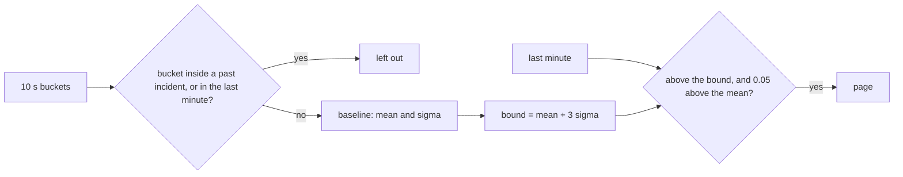

# Flag the anomaly

## The problem

You now have an error rate for every 10 seconds. When is it high enough to page someone?

A fixed line, such as "page above 5%", is wrong for most services. A busy service may live at 3%. A quiet one may live at 0%. So you compare the last minute with what is normal for this service. That normal is the **baseline**.

The 3 sigma rule does this. Sigma is the usual distance of a bucket from the mean. The **bound** is the mean plus three sigma. A minute above the bound is very unlikely to be normal.

The baseline must be clean. If it holds the errors of an earlier incident, the mean and the sigma grow. Then the bound climbs over the next real incident, and nobody is paged.

For example, here is the recorded bad-release morning at 08:25:10. Bookings have failed for five minutes, and two incidents were already opened and closed:

```text
                        baseline_mean   bound    current_error_rate   anomalous
with past incidents          0.057      0.211          0.096              0
without past incidents       0.020      0.092          0.096              1
```

With the past incidents in the baseline, the bound is 21%, and nobody is paged. Without them, the bound is 9%, and the rule pages.



## Your challenge

Open `flag-the-anomaly.sql`. The top part is written for you:

- `incidents` reads the audit log, `sre.incident_events`, and finds when each incident opened and closed.
- `buckets` is your query from the last step. It adds `in_past_incident`: true for a bucket from one minute before an incident opened to one minute after it closed.

Your work is the last SELECT:

1. Build the baseline from every bucket that is older than the last minute and not `in_past_incident`.
2. Set `bound` to `baseline_mean + 3 * baseline_sigma`.
3. Keep the rule for `anomalous`: above the bound, and at least 0.05 above the mean. The 0.05 stops one failed request from paging when the baseline is all zeros.

## Done when

- The bound is the mean plus three sigma, and the baseline is clean.
- Replayed every 30 seconds, the rule pages while the bad release fails bookings.
- It is quiet after the rollback, and through the whole noisy morning.

```bash
bun run verify flag-the-anomaly
```

Expect: `Done. All 8 rules pass.` and a `Progress:` line.

The check replays two recordings. At each moment it moves the recording so that `now()` is that moment, then runs your query.

## If you get stuck

If you keep the past incidents in the baseline, the rule never pages. The check prints:

```text
  FAIL  it pages while the bad release is failing bookings
        Try next: a baseline full of old errors has a high bound; leave the past incidents out, so a normal morning sets the bound
```

| What you see                             | Fix                                                               |
| ---------------------------------------- | ----------------------------------------------------------------- |
| `FAIL the bound is baseline_mean + 3`    | Change the `bound` line. The starter sets it to the mean only.    |
| `FAIL the baseline leaves out`           | Add `AND NOT in_past_incident` to both `avgIf` and `stddevPopIf`. |
| `FAIL it stays quiet after the rollback` | Keep the 0.05 floor in `anomalous`.                               |

## Words you will use

- **Baseline**: the error rate when nothing is wrong. You measure it on clean buckets.
- **Sigma**: the standard deviation, the usual distance of a bucket from the mean.
- **Anomaly**: a value far outside the baseline. Here, above the 3 sigma bound.
