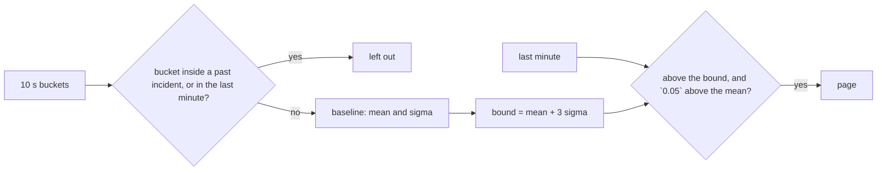

# Flag the anomaly

## The problem

Your error rate now comes every 10 seconds. So compare the last minute with a baseline: what is normal. Past incidents must stay out of the baseline. Or the bound climbs, and nobody is paged.

For example, on the bad-release recording the bound is 0.092 and the current error rate is 0.1125, so the rule pages.

## Watch it done

Here is the bad-release morning at 08:25:10. Bookings had failed for five minutes. Two incidents were already opened and closed:

```text
                        baseline_mean   bound    current_error_rate   anomalous
with past incidents          0.057      0.211          0.096              0
without past incidents       0.020      0.092          0.096              1
```

The bound is the mean plus three sigma. A minute above it is very unlikely to be normal. The baseline must be clean. If it holds the errors of an earlier incident, the bound climbs over the next real incident.



## Your turn

1. Open `flag-the-anomaly.sql`. The top part is written for you:
   - `incidents` reads the audit log, `sre.incident_events`, and finds when each incident opened and closed.
   - `buckets` is your query from the last step. It adds `in_past_incident`: true for a bucket from one minute before an incident opened to one minute after it closed.
2. Build the baseline from every bucket that is older than the last minute and not `in_past_incident`.
3. Set `bound` to `baseline_mean +` `3 *` `baseline_sigma`.
4. Keep the rule for `anomalous`: above the bound, and at least `0.05` above the mean. That small floor stops one failed request from paging when the baseline is all zeros.

## Do it on your work

Pick one service you run, and its error rate for a normal hour. Build the same clean baseline and bound. Good looks like: the rule stays quiet through the hour, and it pages when a real spike of errors starts.

## Done when

- The bound is the mean plus three sigma, and the baseline is clean.
- Replayed every 30 seconds, the rule pages while the bad release fails bookings.
- It is quiet after the rollback, and through the whole noisy morning.

```bash
bun run verify flag-the-anomaly
```

Expect: `Done. All 8 rules pass.` and a `Progress:` line.

The check replays two recordings and runs your query at each moment.

## Solution

The finished rule is in `solution/flag-the-anomaly.sql`.

## If you get stuck

If you keep the past incidents in the baseline, the rule never pages. A baseline full of old errors has a high bound. Leave the past incidents out, so a normal morning sets the bound.

| What you see                             | Fix                                                                 |
| ---------------------------------------- | ------------------------------------------------------------------- |
| `FAIL the bound is baseline_mean + 3`    | Change the `bound` line. The starter sets it to the mean only.      |
| `FAIL the baseline leaves out`           | Add `AND NOT` `in_past_incident` to both `avgIf` and `stddevPopIf`. |
| `FAIL it stays quiet after the rollback` | Keep the `0.05` floor in `anomalous`.                               |

## Words you will use

- **Baseline**: the error rate when nothing is wrong. You measure it on clean buckets.
- **Sigma**: the usual distance of a bucket from the mean.
- **Anomaly**: a value far outside the baseline. Here, above the 3 sigma bound.
