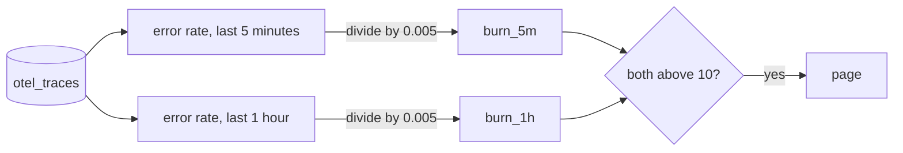

# Burn the budget

## The problem

The 3 sigma rule asks "is this minute strange?". The people who run Gullrock ask a different question: "are we keeping our promise to passengers?".

That promise is an **SLO** (service level objective): 99.5% of booking requests succeed. The other 0.5% is the **error budget**. It is the failures you allow, written as a fraction: 0.005.

The **burn rate** says how fast you spend that budget:

```text
burn rate = error rate / error budget
```

A burn rate of 1 spends the budget at exactly the planned speed. A burn rate of 10 spends it ten times too fast. At 10, a budget meant to last 30 days is gone in 3 days.

You measure the burn over two windows. The short window, 5 minutes, sees a fault quickly. The long window, 1 hour, proves it is not a short burst. You page only while both burn faster than 10.

For example, on the recorded bad-release morning at 08:25:10 the two windows read:

```text
burn_5m   burn_1h   page
 15.21     12.94      1
```

In the last 5 minutes, 7.6% of requests failed. 0.076 / 0.005 is about 15.



## Your challenge

Open `burn-the-budget.sql`. Make it return one row with three columns:

| Column    | Meaning                                                |
| --------- | ------------------------------------------------------ |
| `burn_5m` | the error rate of the last 5 minutes, divided by 0.005 |
| `burn_1h` | the error rate of the last hour, divided by 0.005      |
| `page`    | `burn_5m > 10 AND burn_1h > 10`                        |

The starter already reads the last hour of booking-web requests. For the 5 minute window, count with `countIf` and add `Timestamp > now() - INTERVAL 5 MINUTE` to the condition.

## Done when

- Both burn rates match the reference within 1%, at every replayed moment.
- The page fires only while both windows are above 10.
- It pages for the bad release, is off when that recording ends, and stays quiet on the noisy morning.

```bash
bun run verify burn-the-budget
```

Expect: `Done. All 8 rules pass.` and a `Progress:` line.

## If you get stuck

A common mistake is to divide by the objective, 0.995, instead of the budget, 0.005. Every burn rate then comes out about 200 times too small. The check prints:

```text
  FAIL  burn_5m is the error rate of the last 5 minutes divided by the budget of 0.005
        Try next: count only the last 5 minutes, with countIf(... AND Timestamp > now() - INTERVAL 5 MINUTE), and divide the error rate by 0.005, not by 0.995 or 0.5
```

| What you see                          | Fix                                                                       |
| ------------------------------------- | ------------------------------------------------------------------------- |
| `FAIL burn_1h is the error rate`      | Use every request of the hour: `countIf(StatusCode = 'Error') / count()`. |
| `FAIL the page fires only while both` | Join the two windows with `AND`, not `OR`.                                |
| `FAIL it pages while the bad release` | 0.5% is 0.005, not 0.5.                                                   |

## Words you will use

- **SLO**: a target for a service, such as "99.5% of bookings succeed".
- **Error budget**: the failures the SLO allows. For 99.5%, it is 0.5%, or 0.005.
- **Burn rate**: how fast you spend the error budget. 1 is on plan. 10 is ten times too fast.
