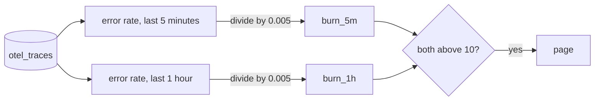

# Burn the budget

## The problem

The 3 sigma rule asks if a minute is strange. Gullrock asks: are we keeping our promise to passengers? Burn rate means how fast you spend the error budget. Your rule pages only while both windows burn above 10.

For example, on the bad-release recording `burn_5m` reads 15.21 and `burn_1h` reads 12.94, so the page fires.

## Watch it done

The promise is an SLO (service level objective): 99.5% of booking requests succeed. The other 0.5% is the error budget, written as 0.005.

```text
burn rate = error rate / error budget
```

A burn rate of 1 spends the budget at exactly the planned speed. A burn rate of 10 spends it ten times too fast. On the bad-release morning at 08:25:10, the two windows read:

```text
burn_5m   burn_1h   page
 15.21     12.94      1
```

In the short window, 7.6% of requests failed. 0.076 / 0.005 is about 15.



## Your turn

1. Open `burn-the-budget.sql`. Make it return one row with three columns:

   | Column    | Meaning                                                  |
   | --------- | -------------------------------------------------------- |
   | `burn_5m` | the error rate of the last `5 minutes`, divided by 0.005 |
   | `burn_1h` | the error rate of the last hour, divided by 0.005        |
   | `page`    | `burn_5m >` `10 AND` `burn_1h >` `10`                    |

2. The starter already reads the last hour of booking-web requests. For the `5 minute` window, count with `countIf` and add `Timestamp > now() - INTERVAL 5 MINUTE` to the condition.
3. Divide by the budget, 0.005. Do not divide by 0.995 or 0.5.

## Do it on your work

Pick a target your team already uses, or write one, such as 99.9% of requests succeed. Work out its error budget. Good looks like: the burn rate stays low on a calm day, and climbs during a real fault.

## Done when

- Both burn rates match the reference within 1%, at every replayed moment.
- The page fires only while both windows are above 10.
- It pages for the bad release, is off when that recording ends, and stays quiet on the noisy morning.

```bash
bun run verify burn-the-budget
```

Expect: `Done. All 8 rules pass.` and a `Progress:` line.

## Solution

The finished rule is in `solution/burn-the-budget.sql`.

## If you get stuck

A common mistake is to divide by the objective, 0.995, instead of the budget, 0.005. Every burn rate then comes out about 200 times too small.

| What you see                          | Fix                                                                       |
| ------------------------------------- | ------------------------------------------------------------------------- |
| `FAIL burn_1h is the error rate`      | Use every request of the hour: `countIf(StatusCode = 'Error') / count()`. |
| `FAIL the page fires only while both` | Join the two windows with `AND`, not `OR`.                                |
| `FAIL it pages while the bad release` | 0.5% is 0.005, not 0.5.                                                   |

## Words you will use

- **SLO**: a target for a service, such as "99.5% of bookings succeed".
- **Error budget**: the failures the SLO allows. For 99.5%, it is 0.5%, or 0.005.
- **Burn rate**: how fast you spend the error budget. 1 is on plan. 10 is ten times too fast.
