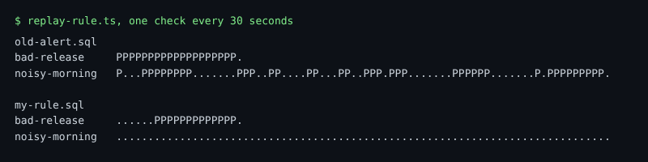

# Count the pages

## The problem

The old alert pages when booking-web writes 3 or more warning or error lines in one minute. Card declines are warning lines. Show the team the numbers before you ask them to switch.

For example, the old alert pages 11 times on the noisy morning, when nothing is broken.

## Watch it done

The old alert and your rule replay through both mornings. Each character is one check, 30 seconds apart:

```text
bad-release     PPPPPPPPPPPPPPPPPPP.
noisy-morning   P...PPPPPPPP.......PPP..PP....PP...PP..PPP.PPP.......PPPPPP.......P.PPPPPPPPP.
```

The first long run on the quiet morning is the TLS blip. Most of the others are card declines.



## Your turn

1. In this folder, paste your whole `burn-the-budget.sql` into `my-rule.sql`.
2. Replay the old alert. Run this from the root of the repo:

```bash
bun parts/02-know-when-it-is-broken/replay-rule.ts parts/02-know-when-it-is-broken/04-count-the-pages/problem/old-alert.sql
```

Expect: two timelines, one for `bad-release` and one for `noisy-morning`.

3. Replay your rule:

```bash
bun parts/02-know-when-it-is-broken/replay-rule.ts parts/02-know-when-it-is-broken/04-count-the-pages/problem/my-rule.sql
```

Expect: one run of `P` on the `bad-release` line, and only dots on the `noisy-morning` line.

4. Count the pages in each replay. A page is one alert that calls a person. It starts when the alert turns on, and it ends when the alert turns off. So one run of `P` is one page, and five checks in a row are still one page. Add up both lines.
5. Write the two totals in `count-the-pages.md`, after `Pages before:` and `Pages after:`.

Do not change `old-alert.sql`. You measure it. You do not fix it.

## Do it on your work

Pick the alert your team uses now. Count its pages over a recent quiet stretch of your own data. Then count the pages of your rule on the same data. Good looks like: a short note with two numbers and one reason.

## Done when

- `my-rule.sql` is your burn rule. It pages for the bad release and stays quiet on the noisy morning.
- `Pages before` is the number of pages the old alert sends in both recordings.
- `Pages after` is the number of pages your rule sends in both recordings.

```bash
bun run verify count-the-pages
```

Expect: `Done. All 6 rules pass.` and a `Progress:` line.

The check replays both rules itself and counts the pages. So your two numbers must match what really happened.

## Solution

The finished files are in `solution/`: `count-the-pages.md`, `my-rule.sql` and `old-alert.sql`.

## If you get stuck

The most common mistake is to count every `P`. A `P` is one check, not one page.

| What you see                                       | Fix                                                                |
| -------------------------------------------------- | ------------------------------------------------------------------ |
| `FAIL my-rule.sql holds your burn-the-budget rule` | Paste the whole file, from the first line to the last.             |
| `FAIL Pages after is the number of pages`          | Count both lines, `bad-release` and `noisy-morning`, and add them. |
| `FAIL old-alert.sql is still the old alert`        | Put the file back as it was. `git checkout` that one file.         |

## Words you will use

- **Page**: one alert that calls a person. It lasts from the moment it turns on until it turns off.
- **Replay**: running a rule again on recorded data, as if the morning were happening now.
- **Alert fatigue**: what happens when pages fire on noise: people stop trusting them.
