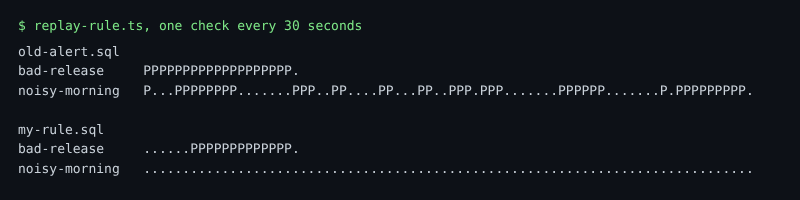

# Count the pages

## The problem

Gullrock already has an alert. It pages when booking-web writes 3 or more warning or error lines in one minute. It sounds careful. But card declines are warning lines, and they happen every hour. So the old alert wakes people for nothing, and they learn to ignore it.

You have written a better rule. Before you ask the team to switch, show them the numbers: how many pages the old alert sends, and how many your rule sends, on the same recorded mornings.

A **page** is one alert that calls a person. An alert that stays on for five checks in a row is still one page. It starts when the alert turns on, and it ends when the alert turns off.

For example, this is the old alert replayed through both recorded mornings. Each character is one check, 30 seconds apart:

```text
bad-release     OLD_ALERT_BAD_RELEASE
noisy-morning   OLD_ALERT_NOISY_MORNING
```



## Your challenge

In this folder:

1. Paste your whole `burn-the-budget.sql` into `my-rule.sql`.
2. Replay the old alert, then your rule. Run these from the root of the repo:

```bash
bun parts/02-know-when-it-is-broken/replay-rule.ts parts/02-know-when-it-is-broken/04-count-the-pages/problem/old-alert.sql
```

Expect: two timelines, one for `bad-release` and one for `noisy-morning`.

```bash
bun parts/02-know-when-it-is-broken/replay-rule.ts parts/02-know-when-it-is-broken/04-count-the-pages/problem/my-rule.sql
```

Expect: one run of `P` on the `bad-release` line, and only dots on the `noisy-morning` line.

3. Count the pages in each replay: one page for each run of `P`. Add up both lines.
4. Write the two totals in `count-the-pages.md`, after `Pages before:` and `Pages after:`.

Do not change `old-alert.sql`. You measure it; you do not fix it.

## Done when

- `my-rule.sql` is your burn rule. It pages for the bad release and stays quiet on the noisy morning.
- `Pages before` is the number of pages the old alert sends in both recordings.
- `Pages after` is the number of pages your rule sends in both recordings.

```bash
bun run verify count-the-pages
```

Expect: `Done. All 6 rules pass.` and a `Progress:` line.

The check replays both rules itself and counts the pages. So your two numbers must match what really happened.

## If you get stuck

The most common mistake is to count every `P`. A `P` is one check, not one page. The check prints:

```text
  FAIL  Pages before is the number of pages the old alert sends in both recordings
        Try next: replay old-alert.sql, then add up the pages of both lines; a run of P next to each other is one page, not one page per P
```

| What you see                                | Fix                                                             |
| ------------------------------------------- | --------------------------------------------------------------- |
| `FAIL my-rule.sql holds your burn-the-budget rule` | Paste the whole file, from the first line to the last.   |
| `FAIL Pages after is the number of pages`   | Count both lines, `bad-release` and `noisy-morning`, and add them. |
| `FAIL old-alert.sql is still the old alert` | Put the file back as it was. `git checkout` that one file.      |

## Words you will use

- **Page**: one alert that calls a person. It lasts from the moment it turns on until it turns off.
- **Replay**: running a rule again on recorded data, as if the morning were happening now.
- **Alert fatigue**: what happens when pages fire on noise: people stop trusting them.
