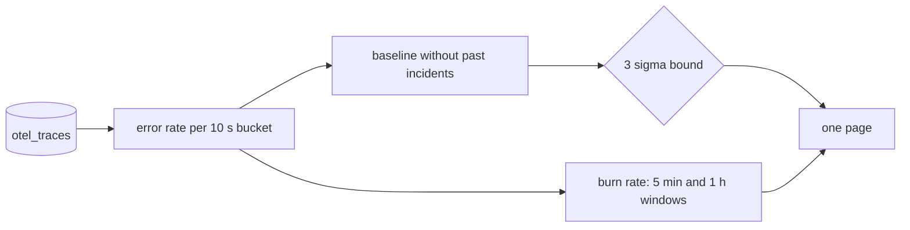

# Know when it is broken

## The problem

A page that fires on noise trains people to ignore pages. Gullrock's passengers decline about 1 card in 30 at every hour, and a detector that pages on that is worse than none. The learner builds a detector that pages once for the bad release and stays silent on a quiet morning with a known card decline rate.

Why it matters: Microsoft's AIOpsLab benchmark includes a problem called no_op that plants no fault at all (github.com/microsoft/AIOpsLab, aiopslab/orchestrator/problems/no_op, read on the build date): a detector is graded on staying quiet as well as on paging.



## Steps

| Step                   | Minutes | You produce                                                           | The check reads                                                                                 |
| ---------------------- | ------- | --------------------------------------------------------------------- | ----------------------------------------------------------------------------------------------- |
| `chart-the-error-rate` | 15      | `chart-the-error-rate.sql`: errors over requests per 10 second bucket | rows against the reference shape on the recorded bad-release window; every rate between 0 and 1 |
| `flag-the-anomaly`     | 20      | a 3 sigma rule over a clean baseline                                  | pages on the recorded bad-release window, silent on the recorded noisy-morning window           |
| `burn-the-budget`      | 20      | SLO burn for a 99.5% booking objective over 5 minutes and 1 hour      | burn rate within 1% of the reference; the page rule fires on bad-release only                   |
| `count-the-pages`      | 15      | `answers/count-the-pages.md`: pages before and after your rule        | replays the recorded windows and gets the same two numbers                                      |

## Walkthrough

TODO(part session): the step folders, their checks and these commands are built in this part's own session.

```bash
bun run verify part know-when-it-is-broken
```

Expect: `Part know-when-it-is-broken is done: 0/0 steps pass.` until the part session adds the steps.

```bash
bun run verify chart-the-error-rate
```

Expect: TODO(part session): the pass line of `chart-the-error-rate`.

```bash
bun run verify flag-the-anomaly
```

Expect: TODO(part session): the pass line of `flag-the-anomaly`.

```bash
bun run verify burn-the-budget
```

Expect: TODO(part session): the pass line of `burn-the-budget`.

```bash
bun run verify count-the-pages
```

Expect: TODO(part session): the pass line of `count-the-pages`.
