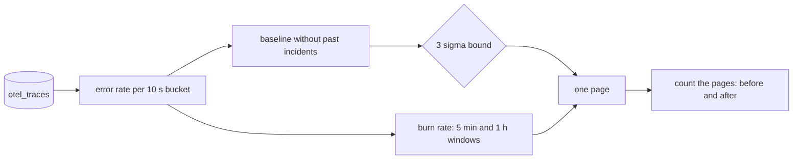

# Know when it is broken

## The problem

A page is an alert that calls a person, even at night. If pages fire on noise, people learn to ignore them. Then they also ignore the real ones.

Some errors at Gullrock are normal. About 1 card in 30 is declined, at every hour. A detector that pages on that is worse than no detector. A detector is the code that watches the numbers and decides when to page.

In this part you build a detector that does two things. It pages for the bad release. It stays quiet on a calm morning, even with the usual card declines.

For example, this is the page that harbour-control's own detector wrote in the recorded bad-release morning:

```text
booking-web error rate 9% over the last minute, above its 3 sigma bound of 8.3% (mean 1.8% over 15 clean 10 s buckets)
```

Here is how to read it, one word at a time:

- The **error rate** is failed requests divided by all requests.
- A **bucket** is a short slice of time, here 10 seconds. You count requests and errors in each bucket.
- The **baseline** is the normal error rate, measured on clean buckets. A clean bucket is one with no past incident in it. Here the mean (average) is 1.8%.
- **Sigma** is the usual distance of a value from the mean. A **3 sigma bound** is the mean plus three sigma. Here that is 8.3%. A value above it is very unlikely to be normal.

And here is a normal card decline from the same morning. Your detector must not page on lines like this:

```text
card declined by payments gateway: do_not_honor for booking GR-4CL8T9
```

You also use a second idea, the burn rate. An **SLO** (service level objective) is a target, such as "99.5% of bookings succeed". The other 0.5% is the error budget: the failures you allow. The **burn rate** says how fast you spend that budget. A burn rate of 1 spends it at exactly the planned speed. A burn rate of 10 spends it ten times too fast.

Why it matters: a detector is graded on silence too, not only on alarms. Microsoft's AIOpsLab test bench has three detection problems that plant no fault at all, one for each of its test apps: hotel reservation, social network and astronomy shop. The only right answer to each is "No". We read them in `aiopslab/orchestrator/problems/no_op` and `registry.py` in github.com/microsoft/AIOpsLab on the build date.

This picture shows the detector you build:



## Steps

You do four steps. Every check runs on two recorded mornings at Gullrock, so you do not need the world running. You can still try each query on the live world in HyperDX.

| Step                   | Minutes | You produce                                                           | The check reads                                                                |
| ---------------------- | ------- | --------------------------------------------------------------------- | ------------------------------------------------------------------------------ |
| `chart-the-error-rate` | 15      | `chart-the-error-rate.sql`: errors over requests per 10 second bucket | every bucket against the reference on the recorded bad-release morning         |
| `flag-the-anomaly`     | 20      | `flag-the-anomaly.sql`: a 3 sigma rule over a clean baseline          | your rule, replayed every 30 s: pages on bad-release, silent on noisy-morning  |
| `burn-the-budget`      | 20      | `burn-the-budget.sql`: burn for a 99.5% objective over 5 min and 1 h  | both burn rates within 1% of the reference; the page fires on bad-release only |
| `count-the-pages`      | 15      | `count-the-pages.md`: pages before and after your rule                | both rules replayed, and the pages counted again, to match your two numbers    |

The two recordings:

- **bad-release**: release v2 of booking-web runs out of database connections, and about 1 booking in 5 fails. The AI SRE rolls it back near the end.
- **noisy-morning**: nothing is broken. There are card declines, as on every morning, and a short TLS blip to the payments gateway that ended long before.

## Walkthrough

Work through the steps in order. Each step folder keeps your starter files in `problem/`. When you finish a step, run its check.

First, chart the error rate of booking-web in 10 second buckets.

```bash
bun run verify chart-the-error-rate
```

Expect: `Done. All 7 rules pass.` once your query is written.

Next, write the 3 sigma rule over a clean baseline.

```bash
bun run verify flag-the-anomaly
```

Expect: `Done. All 8 rules pass.` once your rule pages on the bad release and nowhere else.

Then measure the burn rate of the 99.5% objective.

```bash
bun run verify burn-the-budget
```

Expect: `Done. All 8 rules pass.` once both windows match and the page fires on bad-release only.

You can watch any rule run through both recordings. This replays the sample burn rule:

```bash
bun parts/02-know-when-it-is-broken/replay-rule.ts parts/02-know-when-it-is-broken/03-burn-the-budget/solution/burn-the-budget.sql
```

Expect: a `bad-release` line with one run of `P`, and a `noisy-morning` line with only dots.

Last, count the pages of the old alert and of your rule.

```bash
bun run verify count-the-pages
```

Expect: `Done. All 6 rules pass.` once both numbers match the replay.

This command runs all four checks at once.

```bash
bun run verify part know-when-it-is-broken
```

Expect: `Part know-when-it-is-broken is done: 4/4 steps pass.` after this table:

```text
Part know-when-it-is-broken:
  PASS   chart-the-error-rate  (7/7 rules)
  PASS   flag-the-anomaly  (8/8 rules)
  PASS   burn-the-budget  (8/8 rules)
  PASS   count-the-pages  (6/6 rules)
```

## Assignment

The old alert pages 12 times on the two recorded mornings, and 11 of them are on the morning when nothing is broken. Hand in the rule that replaces it.

- **Hand in**: `burn-the-budget.sql` and `count-the-pages.md` from your `problem/` folders.
- **Checked by**: `bun run verify part know-when-it-is-broken`.

The rubric. Each line is yes or no:

1. Does `bun run verify burn-the-budget` pass?
2. Does `bun run verify count-the-pages` pass?
3. Is `Pages after` smaller than `Pages before`?
4. Does your rule page for the bad release, at least once?
5. Is your rule quiet for the whole noisy morning?

For advanced learners: add a third, slower window, such as 6 hours with a burn above 2. Show with the replay that it would catch a slow leak of 1% errors that the two fast windows miss.

## Finished

You now have a detector you can defend with numbers. It reads the error rate from the traces, compares it with a clean baseline, and pages on the burn of a real objective. The replay shows how many people it would wake: 12 pages with the old alert, 1 with yours.

A page says that something is broken. It does not say what. In the next part, `look-without-touching`, you connect your AI SRE to the telemetry with read-only tools. Then you find the cause of the bad release by hand.
