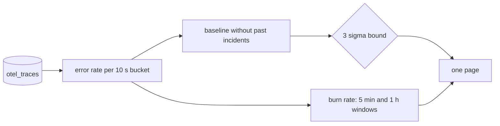

# Know when it is broken

## The problem

A page is an alert that calls a person, even at night. If pages fire on noise, people learn to ignore them. Then they also ignore the real ones.

Some errors at Gullrock are normal. Passengers have about 1 card in 30 declined, at every hour. A detector that pages on that is worse than no detector. A detector is the code that watches the numbers and decides when to page.

In this part you build a detector that does two things. It pages once for the bad release. It stays quiet on a calm morning, even with the usual card declines.

For example, this is the page that harbour-control's own detector wrote in the recorded bad-release morning:

```text
booking-web error rate 9% over the last minute, above its 3 sigma bound of 8.3% (mean 1.8% over 15 clean 10 s buckets)
```

Here is how to read it, one word at a time:

- The **error rate** is failed requests divided by all requests.
- A **bucket** is a short slice of time, here 10 seconds. You count requests and errors in each bucket.
- The **baseline** is the normal error rate, measured on clean buckets. A clean bucket is one with no past incident in it. Here the mean (average) is 1.8%.
- **Sigma** is the usual distance of a value from the mean. A **3 sigma bound** is the mean plus three sigma. Here that is 8.3%. A value above it is very unlikely to be normal.

And here is a normal card decline from the same morning. Your detector must not page on lines like this:

```text
card declined by payments gateway: do_not_honor for booking GR-4CL8T9
```

You also use a second idea, the burn rate. An **SLO** (service level objective) is a target, such as "99.5% of bookings succeed". The other 0.5% is the error budget: the failures you allow. The **burn rate** says how fast you spend that budget. A burn rate of 1 spends it at exactly the planned speed. A burn rate of 10 spends it ten times too fast.

Why it matters: Microsoft's AIOpsLab test has a problem called no_op. It plants no fault at all. So a detector gets a score for staying quiet, not only for paging. The source is aiopslab/orchestrator/problems/no_op in github.com/microsoft/AIOpsLab, read on the build date.

This picture shows the detector you build:



## Steps

| Step                   | Minutes | You produce                                                           | The check reads                                                                                 |
| ---------------------- | ------- | --------------------------------------------------------------------- | ----------------------------------------------------------------------------------------------- |
| `chart-the-error-rate` | 15      | `chart-the-error-rate.sql`: errors over requests per 10 second bucket | rows against the reference shape on the recorded bad-release window; every rate between 0 and 1 |
| `flag-the-anomaly`     | 20      | a 3 sigma rule over a clean baseline                                  | pages on the recorded bad-release window, silent on the recorded noisy-morning window           |
| `burn-the-budget`      | 20      | SLO burn for a 99.5% booking objective over 5 minutes and 1 hour      | burn rate within 1% of the reference; the page rule fires on bad-release only                   |
| `count-the-pages`      | 15      | `answers/count-the-pages.md`: pages before and after your rule        | replays the recorded windows and gets the same two numbers                                      |

## Walkthrough

TODO(part session): this part's own session builds the step folders, their checks and these commands.

This command checks the whole part. It has no steps yet.

```bash
bun run verify part know-when-it-is-broken
```

Expect: `Part know-when-it-is-broken is done: 0/0 steps pass.` until the part session adds the steps.

```bash
bun run verify chart-the-error-rate
```

Expect: TODO(part session): the pass line of `chart-the-error-rate`.

```bash
bun run verify flag-the-anomaly
```

Expect: TODO(part session): the pass line of `flag-the-anomaly`.

```bash
bun run verify burn-the-budget
```

Expect: TODO(part session): the pass line of `burn-the-budget`.

```bash
bun run verify count-the-pages
```

Expect: TODO(part session): the pass line of `count-the-pages`.
