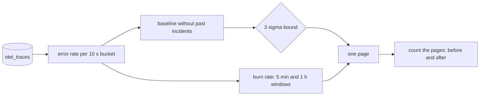

# Know when it is broken

## After this part you can

Build an alert that pages for a real fault and stays quiet on a normal morning. Show the difference with counts.

## You leave with

Your rule, `burn-the-budget.sql`, and a note, `count-the-pages.md`. The note counts the pages of the old alert and of yours. On the two recorded mornings, the old alert sends 12 pages and yours sends 1. In the next part, `look-without-touching`, you connect your AI SRE to the telemetry.

## The problem

An alert that pages for noise teaches people to ignore it. Then they miss the real ones. So a good detector pages for the bad release and stays quiet on a calm morning.

For example, the old alert sends 12 pages over both recordings, and your rule sends 1.

## Background

Errors are normal at Gullrock too. About 1 card in 30 is declined, at every hour.

A detector is graded on silence too, not only on alarms. Microsoft's AIOpsLab test bench has three problems with no fault at all. The only right answer to each is "No". We read them in `aiopslab/orchestrator/problems/no_op` in github.com/microsoft/AIOpsLab.

This picture shows the detector you build:



Some words you will use:

- **Error rate**: failed requests divided by all requests.
- **Bucket**: a short slice of time. Here it is 10 seconds.
- **Baseline**: the normal error rate, measured on clean buckets with no past incident.
- **Sigma**: the usual distance of a value from the mean. A 3 sigma bound is the mean plus three sigma.
- **SLO**: a target, such as "99.5% of bookings succeed".
- **Error budget**: the failures the SLO allows. For 99.5%, that is 0.5%.
- **Burn rate**: how fast you spend the error budget. 1 is on plan. 10 is ten times too fast.

## Steps

You do four steps. Every check runs on two recorded mornings, so you do not need the world running. You can still try each query on the live world in HyperDX.

| Step                   | Minutes | You produce                                                            | The check reads                                                                |
| ---------------------- | ------- | ---------------------------------------------------------------------- | ------------------------------------------------------------------------------ |
| `chart-the-error-rate` | 15      | `chart-the-error-rate.sql`: errors over requests per 10 second bucket  | every bucket against the reference on the recorded bad-release morning         |
| `flag-the-anomaly`     | 20      | `flag-the-anomaly.sql`: a 3 sigma rule over a clean baseline           | your rule, replayed every 30 s: pages on bad-release, silent on noisy-morning  |
| `burn-the-budget`      | 20      | `burn-the-budget.sql`: burn for a 99.5% objective over `5 min` and 1 h | both burn rates within 1% of the reference; the page fires on bad-release only |
| `count-the-pages`      | 15      | `count-the-pages.md`: pages before and after your rule                 | both rules replayed, and the pages counted again, to match your two numbers    |

The two recordings:

- **bad-release**: the new release of booking-web runs out of database connections. About 1 booking in 5 fails. The AI SRE rolls it back near the end.
- **noisy-morning**: nothing is broken. There are card declines, as on every morning. There is also a short TLS blip to the payments gateway that ended long before. TLS is the encryption on a network connection. A blip is a short failure that fixes itself.

## Walkthrough

Work through the steps in order. Each step folder keeps your starter files in `problem/`. When you finish a step, run its check.

First, chart the error rate of booking-web in 10 second buckets.

```bash
bun run verify chart-the-error-rate
```

Expect: `Done. All 7 rules pass.` once your query is written.

Next, write the 3 sigma rule over a clean baseline.

```bash
bun run verify flag-the-anomaly
```

Expect: `Done. All 8 rules pass.` once your rule pages on the bad release and nowhere else.

Then measure the burn rate of the 99.5% objective.

```bash
bun run verify burn-the-budget
```

Expect: `Done. All 8 rules pass.` once both windows match and the page fires on bad-release only.

You can watch any rule run through both recordings. This replays the sample burn rule:

```bash
bun parts/02-know-when-it-is-broken/replay-rule.ts parts/02-know-when-it-is-broken/03-burn-the-budget/solution/burn-the-budget.sql
```

Expect: a `bad-release` line with one run of `P`, and a `noisy-morning` line with only dots.

Last, count the pages of the old alert and of your rule.

```bash
bun run verify count-the-pages
```

Expect: `Done. All 6 rules pass.` once both numbers match the replay.

This command runs all four checks at once.

```bash
bun run verify part know-when-it-is-broken
```

Expect: `Part know-when-it-is-broken is done: 4/4 steps pass.` after this table:

```text
Part know-when-it-is-broken:
  PASS   chart-the-error-rate  (7/7 rules)
  PASS   flag-the-anomaly  (8/8 rules)
  PASS   burn-the-budget  (8/8 rules)
  PASS   count-the-pages  (6/6 rules)
```

## Watch and read

| Kind | Title | Author | Why | Link |
| ---- | ----- | ------ | --- | ---- |

## Project

Do the same moves on one alert your team already has. Pick a service you run. Count its failed and total requests in 10 second buckets. Then count the pages its alert sends on a quiet stretch. Good looks like: a short note with two page counts and one reason.

- **Hand in**: `burn-the-budget.sql` and `count-the-pages.md` from your `problem/` folders.
- **Checked by**: `bun run verify part know-when-it-is-broken`.

The rubric. Each line is yes or no:

1. Does `bun run verify burn-the-budget` pass?
2. Does `bun run verify count-the-pages` pass?
3. Is `Pages after` smaller than `Pages before`?
4. Does your rule page for the bad release, at least once?
5. Is your rule quiet for the whole noisy morning?

For advanced learners: add a third, slower window, such as 6 hours with a burn above 2. Show with the replay that it would catch a slow leak of 1% errors that the two fast windows miss.
