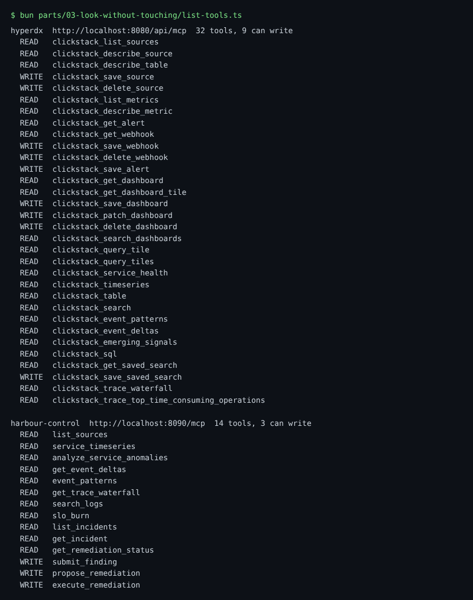

# Connect the read tools

## The problem

Your AI SRE needs to see the telemetry, and never change it. Two MCP servers offer it tools: HyperDX's and harbour-control's. Some tools only read. Others save, delete or run things.

Each tool says what it does with a flag, `readOnlyHint`. But a flag is only a promise from the server. The real lock is the database user: `sre_agent` may only SELECT. So you need both: a client that allows only read tools, and a database that refuses every write.

For example, this is part of what harbour-control's server says about its own tools:

```text
harbour-control  http://localhost:8090/mcp  14 tools, 3 can write
  READ   search_logs
  READ   slo_burn
  WRITE  submit_finding
  WRITE  propose_remediation
  WRITE  execute_remediation
```

And this is ClickHouse when something tries to write as `sre_agent`:

```text
Code: 497. DB::Exception: sre_agent: Not enough privileges. ... (ACCESS_DENIED)
```



## Your challenge

The files in this folder are a Claude Code project: `.mcp.json` names the servers, and `.claude/settings.json` says which tools may run. Other clients use the same `mcpServers` block.

1. List every tool of both servers. The world must be running.

```bash
bun parts/03-look-without-touching/list-tools.ts
```

Expect: `hyperdx  http://localhost:8080/api/mcp  32 tools, 9 can write`, then harbour-control with 14 tools, 3 can write.

2. In `.mcp.json`, add harbour-control at `http://localhost:8090/mcp`, next to HyperDX. Each header names a variable, never the key itself: `"Bearer ${HYPERDX_ACCESS_KEY}"` and `"Bearer ${SRE_MCP_TOKEN}"`.
3. In `.claude/settings.json`, replace `mcp__hyperdx` (the whole server) with single tools. Put READ tools in `allow` and every WRITE tool in `deny`. A tool's full name is `mcp__<server name>__<tool name>`, such as `mcp__hyperdx__clickstack_search`.
4. Try a write as `sre_agent`, and paste the line that starts with `Code:` into `answers.md`, after `ClickHouse said:`.

```bash
bun parts/03-look-without-touching/try-insert.ts
```

Expect: `ClickHouse refused it:` and a line with `ACCESS_DENIED`.

5. Optional: start Claude Code in this folder, with the keys from `.env`, and ask it which tools it has. This also puts the approver password in its shell.

```bash
cd parts/03-look-without-touching/01-connect-the-read-tools/problem && set -a && . ../../../../.env && set +a && claude
```

Expect: Claude Code starts and asks you to approve the two servers of this folder.

## Done when

- `.mcp.json` names both servers, with no key written in it.
- `allow` names only single READ tools, at least one per server, and `deny` holds every WRITE tool.
- ClickHouse refuses an INSERT from `sre_agent`, and `answers.md` shows its answer.

```bash
bun run verify connect-the-read-tools
```

Expect: `Done. All 9 rules pass.` and a `Progress:` line.

## If you get stuck

A common mistake is to allow a tool because its name sounds safe. For example, `clickstack_save_dashboard` only saves a dashboard, but it writes. The check prints:

```text
  FAIL  every allowed tool says readOnlyHint true in its server's tools/list
        Try next: run bun parts/03-look-without-touching/list-tools.ts and allow only tools marked READ; check each name, letter by letter
```

| What you see                         | Fix                                                                       |
| ------------------------------------ | ------------------------------------------------------------------------- |
| `FAIL no key is written`             | Write `${HYPERDX_ACCESS_KEY}`, not the value from `.env`.                 |
| `FAIL every tool that can write`     | Copy every WRITE name from `list-tools.ts` into `deny`, for both servers. |
| `FAIL right now, ClickHouse refuses` | Start the world with `bun run world`.                                     |

## Words you will use

- **MCP server**: a program that offers tools to an AI client, such as `search_logs`.
- **readOnlyHint**: a flag a tool sets to say "I only read". It is a hint, not a lock.
- **Grant**: what a database user may do. `sre_agent` has only `SELECT`.
