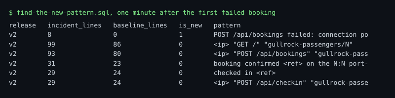

# Find the new pattern

## The problem

The detector paged: bookings are failing. booking-web writes hundreds of log lines a minute. Most of them were there yesterday too. You need the one kind of line that was not there before the trouble started.

A raw log line is hard to compare, because each one holds its own booking reference, address and time. So you mask the parts that change. What is left is a **pattern**. Then all lines of one kind look the same, and you can count them.

For example, these two lines from the recorded bad-release morning:

```text
booking confirmed GR-9AYDGB on the 08:15 port-maren to gullrock for [email]
booking confirmed GR-K5ASFZ on the 06:40 port-maren to gullrock for [email]
```

both become one pattern:

```text
booking confirmed <ref> on the N:N port-maren to gullrock for [email]
```

Then you compare two windows: the last minute (the incident window) and the minute before it (the baseline). A pattern with lines in the incident window and none in the baseline is **new**.



## Your challenge

Open `find-the-new-pattern.sql`. The `pattern`, `incident_start` and `baseline_start` are written for you. Change the SELECT so it returns:

| Column           | Meaning                                                                                    |
| ---------------- | ------------------------------------------------------------------------------------------ |
| `pattern`        | the masked line                                                                            |
| `release`        | the release of the newest line: `argMax(ResourceAttributes['service.version'], Timestamp)` |
| `incident_lines` | lines in the last minute: `countIf(Timestamp >= incident_start)`                           |
| `baseline_lines` | lines in the minute before                                                                 |
| `is_new`         | `baseline_lines = 0 AND incident_lines > 0`                                                |

Read both windows: `Timestamp >= baseline_start`. Keep only patterns with lines in the incident window. Put new patterns first, then the most lines.

## Done when

- Each row is a pattern, with the five columns.
- The access log line is not new: it was in the baseline too.
- The top row is the connection pool error, it is new, and it comes from release v2.

```bash
bun run verify find-the-new-pattern
```

Expect: `Done. All 7 rules pass.` and a `Progress:` line.

The check plays the recorded bad-release morning back to one minute after the first booking failed. Then it runs your query.

## If you get stuck

If you count only the incident window, every pattern looks new. Then the busiest line, the access log, comes out on top. The check prints:

```text
  FAIL  the access log line is not new: it was there in the baseline too
        Try next: read the baseline minute too: WHERE Timestamp >= baseline_start, and is_new is baseline_lines = 0 AND incident_lines > 0
```

| What you see                                        | Fix                                          |
| --------------------------------------------------- | -------------------------------------------- |
| `FAIL each row is a pattern`                        | Group by `pattern`, not by `Body`.           |
| `FAIL the top row is the new connection pool error` | `ORDER BY is_new DESC, incident_lines DESC`. |
| `FAIL the top row is new, it comes from release v2` | Add the `release` column with `argMax`.      |

## Words you will use

- **Pattern**: a log line with its changing parts, such as references and numbers, masked.
- **Incident window**: the time when things went wrong. Here, the last minute.
- **Baseline**: a time just before, when things were normal. Here, the minute before.
