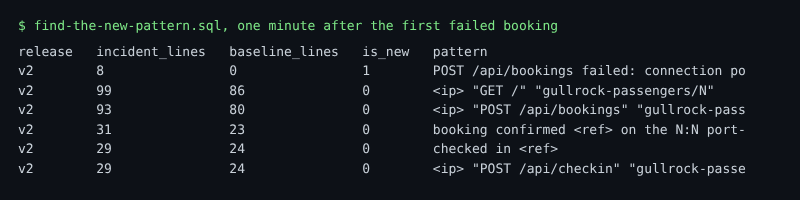

# Find the new pattern

## The problem

The alarm went off: bookings are failing. booking-web writes hundreds of log lines a minute. You need the one kind of line that is new.

Masking the parts that change turns many lines into one pattern. For example, two lines from the bad-release morning:

```text
booking confirmed GR-9AYDGB on the 08:15 port-maren to gullrock for [email]
booking confirmed GR-K5ASFZ on the 06:40 port-maren to gullrock for [email]
```

Both become one pattern:

```text
booking confirmed <ref> on the N:N port-maren to gullrock for [email]
```

## Watch it done

The new pattern is on top, on the recorded bad-release morning. The check shows:



## Your turn

1. Open `find-the-new-pattern.sql`. The `pattern`, `incident_start` and `baseline_start` are written for you.
2. Change the SELECT so it returns these five columns:

| Column           | Meaning                                                                                    |
| ---------------- | ------------------------------------------------------------------------------------------ |
| `pattern`        | the masked line                                                                            |
| `release`        | the release of the newest line: `argMax(ResourceAttributes['service.version'], Timestamp)` |
| `incident_lines` | lines in the last minute: `countIf(Timestamp >= incident_start)`                           |
| `baseline_lines` | lines in the minute before                                                                 |
| `is_new`         | `baseline_lines = 0 AND incident_lines > 0`                                                |

3. Read both windows with `Timestamp >= baseline_start`. Keep only patterns with lines in the incident window. Add this line after the `GROUP BY`:

```sql
HAVING incident_lines > 0
```

4. Put new patterns first, then the most lines:

```sql
ORDER BY is_new DESC, incident_lines DESC
```

## Do it on your work

Run the same query on your own service's logs. Use a bad hour as the incident window, and the hour before it as the baseline. Good looks like: a line that is new in the bad hour shows up on top, and normal lines do not.

## Done when

- Each row is a pattern, with the five columns.
- The access log line is not new: it was in the baseline too. The access log is the line booking-web writes for every request.
- The top row is the connection pool error, it is new, and it comes from release `v2`.

```bash
bun run verify find-the-new-pattern
```

Expect: `Done. All 7 rules pass.` and a `Progress:` line.

The check plays the recorded bad-release morning back to one minute after the first booking failed. Then it runs your query.

## Solution

The finished query is in `solution/find-the-new-pattern.sql`.

## If you get stuck

If you count only the incident window, every pattern looks new. Then the busiest line, the access log, comes out on top. The check prints:

```text
  FAIL  the access log line is not new: it was there in the baseline too
        Try next: read the baseline minute too: WHERE Timestamp >= baseline_start, and is_new is baseline_lines = 0 AND incident_lines > 0
```

| What you see                                        | Fix                                                     |
| --------------------------------------------------- | ------------------------------------------------------- |
| `FAIL each row is a pattern`                        | Group by `pattern`, not by `Body`.                      |
| `FAIL the top row is the new connection pool error` | Sort by `is_new` and `incident_lines`, both descending. |
| `FAIL the top row is new, it comes from release v2` | Add the `release` column with `argMax`.                 |

## Words you will use

- **Pattern**: a log line with its changing parts, such as references and numbers, masked.
- **Incident window**: the time when things went wrong. Here, the last minute.
- **Baseline**: a time just before, when things were normal. Here, the minute before.
