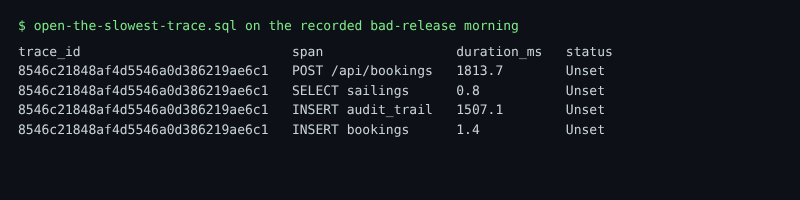

# Open the slowest trace

## The problem

The new pattern says "connection pool exhausted". booking-web has only two database connections. Something holds them too long. A count cannot tell you what. One trace can.

A trace is every span of one request. Its spans show where the time went. So you open the slowest booking and read its spans, one by one.

For example, on the recorded bad-release morning a failed booking looks like this. It waited about 300 ms for a free connection, then gave up:

```text
span                  duration_ms   status
POST /api/bookings          316.9   Error
SELECT sailings               0.5   Unset
```

The failed bookings are the victims. The slowest booking that worked shows who holds the connections.



## Your challenge

Open `open-the-slowest-trace.sql`. The outer SELECT lists every span of one trace. The inner SELECT, in brackets, picks the trace. Right now it picks any booking.

Change the inner SELECT so it picks the slowest `POST /api/bookings` of the last 15 minutes. Then run the query and read the spans. Which one takes most of the time?

`Duration` is in nanoseconds. The starter divides it by 1e6, so `duration_ms` is in milliseconds.

## Done when

- Every row belongs to one trace: the slowest booking of the last 15 minutes.
- The rows list every span of that trace.
- One of them is `INSERT audit_trail`, and it takes more than 1 second.

```bash
bun run verify open-the-slowest-trace
```

Expect: `Done. All 7 rules pass.` and a `Progress:` line.

The check runs your query on the recorded bad-release morning. On the live world, paste the trace id into HyperDX's search to see the same spans as a waterfall.

## If you get stuck

`ORDER BY Duration` sorts from the fastest. The check prints:

```text
  FAIL  the trace is the slowest booking of the last 15 minutes
        Try next: in the inner SELECT, add ORDER BY Duration DESC before LIMIT 1; DESC puts the slowest first
```

| What you see                             | Fix                                                                                    |
| ---------------------------------------- | -------------------------------------------------------------------------------------- |
| `FAIL every row belongs to one trace`    | Keep `LIMIT 1` at the end of the inner SELECT.                                         |
| `FAIL it shows the slow span`            | Do not filter on `StatusCode`. The slowest failed booking never reached the slow span. |
| `FAIL it lists every span of that trace` | Do not filter the outer SELECT on `SpanName`.                                          |

## Words you will use

- **Trace**: every span of one request, across every service. One trace id links them.
- **Waterfall**: a trace drawn as bars, one per span, so you see where the time went.
- **Connection pool**: a small set of open database connections that requests share.
