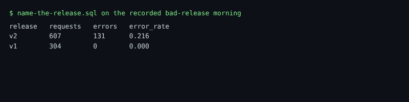

# Name the release

## The problem

You have a new error and a slow INSERT. One question is left before you can say what broke: what changed? Most incidents follow a change. At Gullrock, the change is usually a new release of booking-web.

Every span carries its release in `ResourceAttributes['service.version']`. You added that in part one. Now it pays off: split the booking errors by release, and see whether one release owns them.

For example, on the recorded bad-release morning, split by release, the bookings look like this:

```text
release   requests   errors   error_rate
v2             607      131       0.216
v1             304        0       0
```

Release v1 failed no booking. Release v2 failed about 1 in 5.



## Your challenge

Open `name-the-release.sql`. Write one SELECT over `otel_traces` with one row per release:

| Column       | Meaning                                 |
| ------------ | --------------------------------------- |
| `release`    | `ResourceAttributes['service.version']` |
| `requests`   | booking requests served by that release |
| `errors`     | how many of them failed                 |
| `error_rate` | `errors / requests`                     |

Count only booking requests: booking-web spans with `SpanKind = 'Server'` and `SpanName = 'POST /api/bookings'`, in the last 15 minutes. Put the worst release first.

## Done when

- There is one row for v1 and one for v2, with the same counts as the telemetry.
- v2 fails more than 20% of bookings, and v1 under 1%.
- The worst release is the first row.

```bash
bun run verify name-the-release
```

Expect: `Done. All 7 rules pass.` and a `Progress:` line.

## If you get stuck

The release is a resource attribute: the whole service shares it, so it is not on each span's own attributes. The check prints:

```text
  FAIL  there is one row for each release, v1 and v2
        Try next: GROUP BY release; the release lives in ResourceAttributes, not in SpanAttributes, because the whole service shares it
```

| What you see                                         | Fix                                                                            |
| ---------------------------------------------------- | ------------------------------------------------------------------------------ |
| `FAIL each release counts only its booking requests` | Page views and database calls never fail here. Keep only `POST /api/bookings`. |
| `FAIL the worst release comes first`                 | `ORDER BY error_rate DESC`.                                                    |

## Words you will use

- **Release**: one deployed version of a service, such as v1 or v2.
- **Resource attribute**: a name and value that belong to the whole service, such as its release.
- **Span attribute**: a name and value that belong to one span, such as `booking.ref`.
