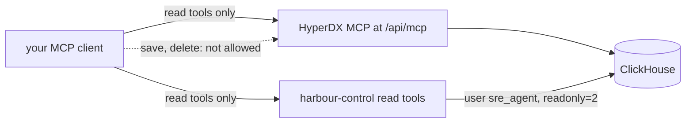

# Look without touching

## The problem

The most common fear of an AI on call is that it changes production. The answer is a read path the model cannot write through, enforced by the database grant, not the prompt. Then the learner finds the cause of bad-release by hand, so they can judge the AI SRE later.

Why it matters: ClickHouse's own ClickStack 2.44.0 ships an MCP server with 32 tools, and 9 of them can create, change or delete things (each declares readOnlyHint false). Counted from the tools/list answer of the clickhouse/clickstack-all-in-one:2.44.0 image on the build date.



## Steps

| Step | Minutes | You produce | The check reads |
|---|---|---|---|
| `connect-the-read-tools` | 20 | your MCP client connected to HyperDX's MCP and harbour-control, read tools only | the client's MCP config and tools/list: every allowed tool has readOnlyHint true; an INSERT as sre_agent is refused |
| `find-the-new-pattern` | 20 | `find-the-new-pattern.sql`: log patterns new in the incident window | the top row on the recorded bad-release window is the pool exhausted pattern on release v2 |
| `open-the-slowest-trace` | 15 | `open-the-slowest-trace.sql`: failing first, then slowest | the first trace id is a failing booking-web trace with an audit_trail span over 1 s |
| `name-the-release` | 15 | errors by release for the incident window | v2 error rate above 25%, v1 under 1%, on the recording |

## Walkthrough

TODO(part session): the step folders, their checks and these commands are built in this part's own session.

```bash
bun run verify part look-without-touching
```

Expect: `Part look-without-touching is done: 0/0 steps pass.` until the part session adds the steps.

```bash
bun run verify connect-the-read-tools
```

Expect: TODO(part session): the pass line of `connect-the-read-tools`.

```bash
bun run verify find-the-new-pattern
```

Expect: TODO(part session): the pass line of `find-the-new-pattern`.

```bash
bun run verify open-the-slowest-trace
```

Expect: TODO(part session): the pass line of `open-the-slowest-trace`.

```bash
bun run verify name-the-release
```

Expect: TODO(part session): the pass line of `name-the-release`.
