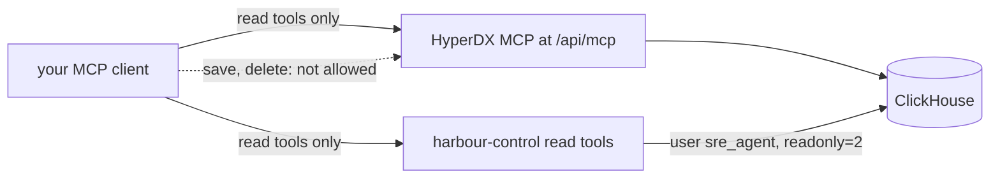

# Look without touching

## The problem

Many people fear one thing about an AI on call: that it changes production by mistake. Production is the real system that passengers use.

The answer is a read path. A read path lets the AI look at data, but never change it. The database enforces this with its user rights, not the prompt. A prompt is only a request to the model, and a model can ignore it.

For example, the AI SRE talks to ClickHouse as the user `sre_agent`. In `world/clickhouse/sre.xml`, that user has this setting:

```text
<readonly>2</readonly>
```

With `readonly` set to 2, ClickHouse refuses every INSERT from `sre_agent`. The model cannot write, whatever its prompt says.

Then you find the cause of bad-release by hand. You do it yourself first, so you can judge the AI SRE later. For example, the most common error line in the recorded bad-release morning is this one. It appears 84 times:

```text
POST /api/bookings failed: connection pool exhausted: 2 of 2 connections in use (audit_trail) ref=HX-Y3JVTA
```

The AI uses tools through MCP. MCP (Model Context Protocol) is a standard way to give an AI model tools. An MCP server lists its tools. An MCP client, such as your agent, calls them. Each tool can declare `readOnlyHint`. When it is true, the tool says it only reads.

Why it matters: ClickStack 2.44.0 from ClickHouse ships an MCP server with 32 tools. Nine of them can create, change or delete things. Each of those nine declares readOnlyHint false. We counted them in the tools/list answer of the clickhouse/clickstack-all-in-one:2.44.0 image on the build date.

This picture shows the read path. The dotted line is what the agent may not do.



## Steps

| Step                     | Minutes | You produce                                                                     | The check reads                                                                                                     |
| ------------------------ | ------- | ------------------------------------------------------------------------------- | ------------------------------------------------------------------------------------------------------------------- |
| `connect-the-read-tools` | 20      | your MCP client connected to HyperDX's MCP and harbour-control, read tools only | the client's MCP config and tools/list: every allowed tool has readOnlyHint true; an INSERT as sre_agent is refused |
| `find-the-new-pattern`   | 20      | `find-the-new-pattern.sql`: log patterns new in the incident window             | the top row on the recorded bad-release window is the pool exhausted pattern on release v2                          |
| `open-the-slowest-trace` | 15      | `open-the-slowest-trace.sql`: failing first, then slowest                       | the first trace id is a failing booking-web trace with an audit_trail span over 1 s                                 |
| `name-the-release`       | 15      | errors by release for the incident window                                       | v2 error rate above 25%, v1 under 1%, on the recording                                                              |

## Walkthrough

TODO(part session): this part's own session builds the step folders, their checks and these commands.

This command checks the whole part. It has no steps yet.

```bash
bun run verify part look-without-touching
```

Expect: `Part look-without-touching is done: 0/0 steps pass.` until the part session adds the steps.

```bash
bun run verify connect-the-read-tools
```

Expect: TODO(part session): the pass line of `connect-the-read-tools`.

```bash
bun run verify find-the-new-pattern
```

Expect: TODO(part session): the pass line of `find-the-new-pattern`.

```bash
bun run verify open-the-slowest-trace
```

Expect: TODO(part session): the pass line of `open-the-slowest-trace`.

```bash
bun run verify name-the-release
```

Expect: TODO(part session): the pass line of `name-the-release`.
