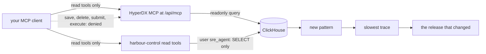

# Look without touching

## After this part you can

Give an AI helper read-only access, and prove the database refuses writes. You also find the bad release by hand.

## You leave with

A client config, `.mcp.json` and `.claude/settings.json`, that allows only read tools. An `answers.md` that shows ClickHouse refusing a write. Three SQL queries that find the bad release, and one metrics answer.

## The problem

An AI on call can change production by mistake. A model can ignore a prompt, so the database must enforce the rule with its user rights.

For example, one error line appears 84 times on the bad-release morning:

```text
POST /api/bookings failed: connection pool exhausted: 2 of 2 connections in use (audit_trail) ref=HX-Y3JVTA
```

First, find the cause of the bad release by hand. Then judge the AI SRE later.

## The read path

A read path lets the AI look at data, but never change it. The AI SRE uses the database user `sre_agent`. In `world/clickhouse/sre.xml`, that user has two locks:

```text
<query>GRANT SELECT ON default.*</query>
<readonly>2</readonly>
```

The grant lets `sre_agent` read and nothing else. The `readonly` setting stops it from changing its own settings. When something writes as `sre_agent`, ClickHouse answers:

```text
Code: 497. DB::Exception: sre_agent: Not enough privileges. ... (ACCESS_DENIED)
```

This lock covers one database user only. The HyperDX tool `clickstack_sql` uses another connection. So the `sre_agent` lock does not cover it. For HyperDX, your protection is the `readOnlyHint` flag and your deny list. A flag is only a promise, so the deny list matters.

One more limit. The file `.env` holds the approver password, `SRE_APPROVER_PASSWORD`. If you load `.env` into the shell that starts your agent, the agent can read it. In this workshop, keep the approver login to yourself. In production, give the agent its own environment.

MCP (Model Context Protocol) is a standard way to give an AI model tools. Each tool can declare `readOnlyHint`. When it is true, the tool says it only reads. ClickStack from ClickHouse ships an MCP server with 32 tools.

Nine of them can write, such as `clickstack_delete_dashboard`. Each of those nine declares readOnlyHint false. An AI client that allows the whole server allows all nine.

The diagram shows the read path. The dotted line is what the agent may not do.



## Steps

You do five steps. The first one needs the world running. The other four run on the recorded bad-release morning, so the check gives the same answer on every machine.

| Step                       | Minutes | You produce                                                                  | The check reads                                                                       |
| -------------------------- | ------- | ---------------------------------------------------------------------------- | ------------------------------------------------------------------------------------- |
| `connect-the-read-tools`   | 20      | `.mcp.json` and `.claude/settings.json`: both servers, read tools only       | your config against each server's tools/list; a real INSERT as sre_agent, refused     |
| `find-the-new-pattern`     | 20      | `find-the-new-pattern.sql`: log patterns new in the incident window          | the top row, one minute after the first failure: the pool error, new, on release `v2` |
| `open-the-slowest-trace`   | 15      | `open-the-slowest-trace.sql`: every span of the slowest booking              | the trace id, its spans, and an `INSERT audit_trail` over 1 s                         |
| `name-the-release`         | 15      | `name-the-release.sql`: booking errors by release                            | `v2` fails more than 20% of bookings, `v1` under 1%, on the recording                 |
| `read-the-service-metrics` | 15      | `answers/read-the-service-metrics.md`: worst service, rate, first bad minute | the numbers worked out again from `metrics.csv` (by hand, not with the read tools)    |

## Walkthrough

Start the world once.

```bash
bun run world
```

Expect: `The world is up: every service is healthy.`

First, list every tool both servers offer.

```bash
bun parts/03-look-without-touching/list-tools.ts
```

Expect: `hyperdx  http://localhost:8080/api/mcp  32 tools, 9 can write`, and below it `harbour-control  http://localhost:8090/mcp  14 tools, 3 can write`.

Then try to write as the AI SRE's database user.

```bash
bun parts/03-look-without-touching/try-insert.ts
```

Expect: "ClickHouse refused it:" and a line that ends in `(ACCESS_DENIED)` and the ClickHouse version.

Now allow the read tools, and deny the rest.

```bash
bun run verify connect-the-read-tools
```

Expect: `Done. All 9 rules pass.` once your config allows only read tools.

Next, find the log pattern that is new in the incident.

```bash
bun run verify find-the-new-pattern
```

Expect: `Done. All 7 rules pass.` once the pool error is the top row.

Then open the slowest booking and read its spans.

```bash
bun run verify open-the-slowest-trace
```

Expect: `Done. All 7 rules pass.` once your query lists the spans of the slowest booking.

Split the booking errors by release.

```bash
bun run verify name-the-release
```

Expect: `Done. All 7 rules pass.` once `v2` is the first row.

Last, read the service metrics by hand.

```bash
bun run verify read-the-service-metrics
```

Expect: `Done. All 4 rules pass.` once your answer names the worst service and the first bad minute.

This command runs all five checks at once.

```bash
bun run verify part look-without-touching
```

Expect: `Part look-without-touching is done: 5/5 steps pass.` after this table:

```text
Part look-without-touching:
  PASS   connect-the-read-tools  (9/9 rules)
  PASS   find-the-new-pattern  (7/7 rules)
  PASS   open-the-slowest-trace  (7/7 rules)
  PASS   name-the-release  (7/7 rules)
  PASS   read-the-service-metrics  (4/4 rules)
```

## Watch and read

| Kind | Title                                    | Author                      | Why                                                                   | Link                                                           |
| ---- | ---------------------------------------- | --------------------------- | --------------------------------------------------------------------- | -------------------------------------------------------------- |
| read | How we built Claude Code auto mode       | Anthropic research          | Shows why people say yes without reading, and what to do about it.    | <https://www.anthropic.com/research/claude-code-auto-mode>     |
| read | Making Claude Code safer with sandboxing | Anthropic engineering blog  | Explains the walled room that the sandbox setting turns on.           | <https://www.anthropic.com/engineering/claude-code-sandboxing> |
| read | Configure permissions                    | Claude Code docs, Anthropic | The home of modes and deny rules, written by the team that made them. | <https://code.claude.com/docs/en/permissions>                  |
| read | Best practices for Claude Code           | Claude Code docs, Anthropic | Covers plan mode, @ files and screenshots as ways to ask well.        | <https://code.claude.com/docs/en/best-practices>               |
| read | Common workflows                         | Claude Code docs, Anthropic | Step by step uses of images, @ mentions and reviewing changes.        | <https://code.claude.com/docs/en/common-workflows>             |

## Project

Pick one service you run. Give its AI helper a read-only config. List its tools, allow the read ones, and deny every write. Try one write as its database user, and save the refusal. Then write a short note that names one denied tool and why it must stay denied.
