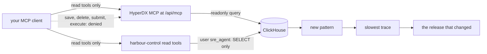

# Look without touching

## The problem

Many people fear one thing about an AI on call: that it changes production by mistake. Production is the real system that passengers use.

The answer is a read path. A read path lets the AI look at data, but never change it. The database enforces this with its user rights, not the prompt. A prompt is only a request to the model, and a model can ignore it.

For example, the AI SRE talks to ClickHouse as the user `sre_agent`. In `world/clickhouse/sre.xml`, that user has two locks:

```text
<query>GRANT SELECT ON default.*</query>
<readonly>2</readonly>
```

The grant lets `sre_agent` read and nothing else. The `readonly` setting stops it from changing its own settings to get around that. When something tries to write as `sre_agent`, ClickHouse answers:

```text
Code: 497. DB::Exception: sre_agent: Not enough privileges. ... (ACCESS_DENIED)
```

As `sre_agent`, the model cannot write, whatever its prompt says.

This lock covers one database user only. The HyperDX MCP tool `clickstack_sql` uses a different connection, so the `sre_agent` lock does not cover it. For HyperDX, your protection is the `readOnlyHint` flag and your deny list. A flag is only a promise, so the deny list matters.

One more limit. The file `.env` also holds the approver password (`SRE_APPROVER_PASSWORD`). If you load `.env` into the shell that starts your agent, the agent can read that password. In this workshop, you keep the approver login to yourself. In production, give the agent its own environment with no approver login.

Then you find the cause of bad-release by hand. You do it yourself first, so you can judge the AI SRE later. For example, the most common error line in the recorded bad-release morning is this one. It appears 84 times:

```text
POST /api/bookings failed: connection pool exhausted: 2 of 2 connections in use (audit_trail) ref=HX-Y3JVTA
```

The AI uses tools through MCP. MCP (Model Context Protocol) is a standard way to give an AI model tools. An MCP server lists its tools. An MCP client, such as your agent, calls them. Each tool can declare `readOnlyHint`. When it is true, the tool says it only reads.

Why it matters: ClickStack 2.44.0 from ClickHouse ships an MCP server with 32 tools. Nine of them can create, change or delete things, such as `clickstack_delete_dashboard`. Each of those nine declares readOnlyHint false. We counted them in the tools/list answer of the clickhouse/clickstack-all-in-one:2.44.0 image on the build date. An AI client that allows the whole server allows all nine.

This picture shows the read path. The dotted line is what the agent may not do.



## Steps

You do four steps. The first one needs the world running. The other three run on the recorded bad-release morning, so the check gives the same answer on every machine.

| Step                     | Minutes | You produce                                                            | The check reads                                                                     |
| ------------------------ | ------- | ---------------------------------------------------------------------- | ----------------------------------------------------------------------------------- |
| `connect-the-read-tools` | 20      | `.mcp.json` and `.claude/settings.json`: both servers, read tools only | your config against each server's tools/list; a real INSERT as sre_agent, refused   |
| `find-the-new-pattern`   | 20      | `find-the-new-pattern.sql`: log patterns new in the incident window    | the top row, one minute after the first failure: the pool error, new, on release v2 |
| `open-the-slowest-trace` | 15      | `open-the-slowest-trace.sql`: every span of the slowest booking        | the trace id, its spans, and an `INSERT audit_trail` over 1 s                       |
| `name-the-release`       | 15      | `name-the-release.sql`: booking errors by release                      | v2 fails more than 20% of bookings, v1 under 1%, on the recording                   |

## Walkthrough

Start the world once. The first step lists the tools of the live MCP servers.

```bash
bun run world
```

Expect: `The world is up: every service is healthy.`

First, look at every tool both servers offer.

```bash
bun parts/03-look-without-touching/list-tools.ts
```

Expect: `hyperdx  http://localhost:8080/api/mcp  32 tools, 9 can write`, and below it `harbour-control  http://localhost:8090/mcp  14 tools, 3 can write`.

Then try to write as the AI SRE's database user.

```bash
bun parts/03-look-without-touching/try-insert.ts
```

Expect: `ClickHouse refused it:` and a line that ends in `(ACCESS_DENIED)` and the ClickHouse version.

Now allow the read tools, and deny the rest.

```bash
bun run verify connect-the-read-tools
```

Expect: `Done. All 9 rules pass.` once your config allows only read tools.

Next, find the log pattern that is new in the incident.

```bash
bun run verify find-the-new-pattern
```

Expect: `Done. All 7 rules pass.` once the pool error is the top row.

Then open the slowest booking and read its spans.

```bash
bun run verify open-the-slowest-trace
```

Expect: `Done. All 7 rules pass.` once your query lists the spans of the slowest booking.

Last, split the booking errors by release.

```bash
bun run verify name-the-release
```

Expect: `Done. All 7 rules pass.` once v2 is the first row.

This command runs all four checks at once.

```bash
bun run verify part look-without-touching
```

Expect: `Part look-without-touching is done: 4/4 steps pass.` after this table:

```text
Part look-without-touching:
  PASS   connect-the-read-tools  (9/9 rules)
  PASS   find-the-new-pattern  (7/7 rules)
  PASS   open-the-slowest-trace  (7/7 rules)
  PASS   name-the-release  (7/7 rules)
```

## Assignment

The team will not let an AI near production. Show them a read path they can check.

- **Hand in**: `.mcp.json`, `.claude/settings.json` and `answers.md` from `connect-the-read-tools`, and your `find-the-new-pattern.sql`.
- **Checked by**: `bun run verify connect-the-read-tools` and `bun run verify find-the-new-pattern`.

The rubric. Each line is yes or no:

1. Does `bun run verify connect-the-read-tools` pass?
2. Does every allowed tool say readOnlyHint true?
3. Is every tool that can write in the deny list?
4. Does `answers.md` show ClickHouse refusing the INSERT?
5. Does `bun run verify find-the-new-pattern` pass?

For advanced learners: write a short note, `why-the-hint-is-not-the-lock.md`. Explain why `readOnlyHint` alone is not enough. Then show it with a real call: ask your client to run an INSERT through `clickstack_sql`, a tool that says it only reads. Paste what HyperDX answers.

## Finished

You now have a read path you can defend. Your client allows only tools that say they read. It denies every tool that can write. And the `sre_agent` database user refuses a write, even if a harbour-control tool lies. The HyperDX MCP uses another connection, so for that server your deny list is the lock. With those tools you found the cause of bad-release by hand: a new error pattern, a slow `INSERT audit_trail` that holds the two connections, and one release that owns every failed booking.

In the next part, `say-what-broke`, your AI SRE does the same investigation. It writes a finding that names the service, the release and the pattern, and cites trace ids that a script can look up. A finding with a made-up trace id is refused. The checks have limits, and the next part says what they are.
