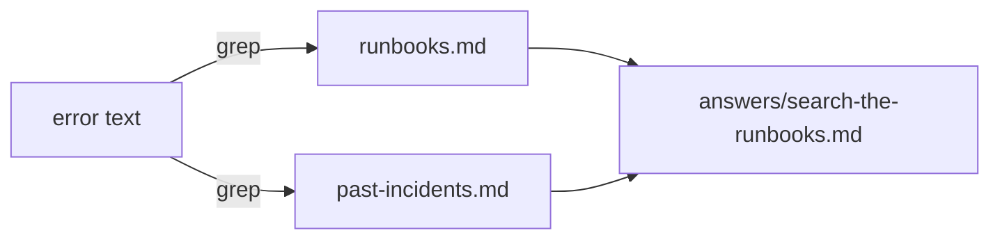

# Search the runbooks

## The problem

Most pages are not new. A team has often seen the same error before and written down what to do. The AI SRE should look there first, and so should you. A runbook is a short page that says what to do for one kind of problem. For example, the error `connection slots are reserved` points at one runbook.



## Watch it done

The error text is `FATAL remaining connection slots are reserved`. A search for the words `connection slots` finds one runbook and one past incident. The runbook says to compare errors by release.

## Your challenge

Open `answers/search-the-runbooks.md` in this folder. The symptom is already filled in.

1. Search both files for the words of the symptom:

```bash
grep -i "connection slots" runbooks.md past-incidents.md
```

Expect: one line from `runbooks.md` and one line from `past-incidents.md`.

2. Write the search you ran after `Search:`.
3. Write the runbook title after `Runbook:`, and the incident id after `Past incident:`.
4. Copy one line from the runbook after `Quote:`, word for word.

```bash
bun run verify search-the-runbooks
```

Expect: `Done. All 4 rules pass.` and a `Progress:` line.

## Do it on your work

Run the same search over your own runbooks and your last ten tickets. Good looks like this: you find the page that matches, or you learn that you have none, and that is your first runbook to write.

## Done when

- The answer shows the search you ran.
- The runbook and the past incident both match the symptom.
- The quote is a real line from the runbook.

## If you get stuck

| What you see                                     | Fix                                                                  |
| ------------------------------------------------ | -------------------------------------------------------------------- |
| `FAIL the named runbook is the one that matches` | Copy the title after `## Runbook:` for the page that has your words. |
| `FAIL the past incident is in past-incidents.md` | Copy the id exactly. It starts with `inc-`.                          |

## Words you will use

- **Runbook**: a short page that says what to do for one kind of problem.
- **Past incident**: a problem the team already had, with its cause and its fix.
- **Symptom**: what you see on the screen, such as an error line.
