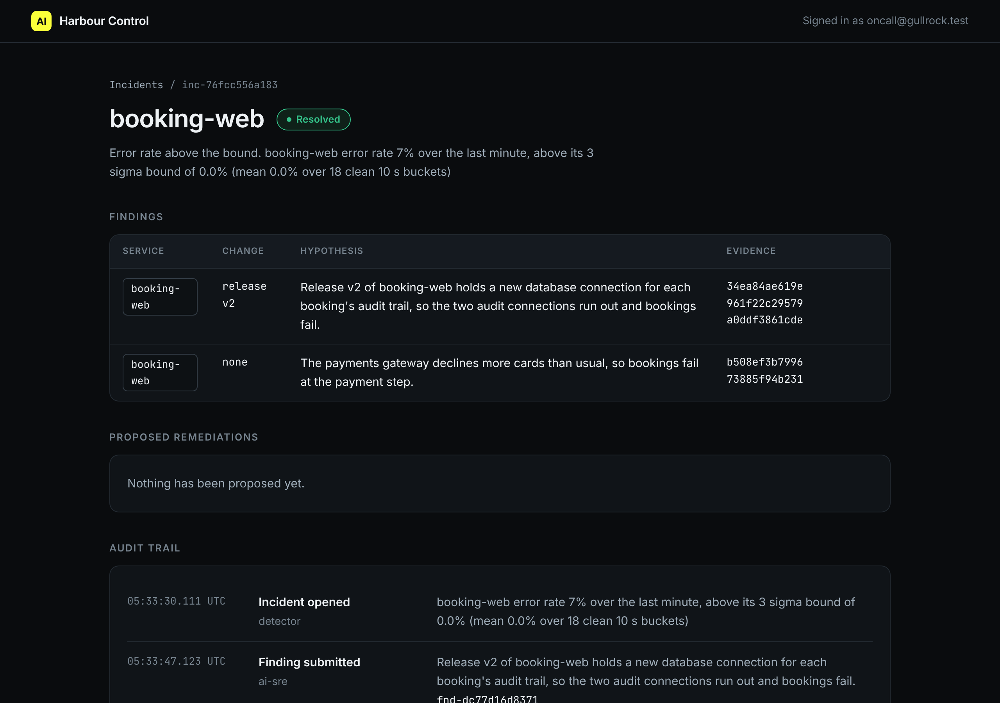

# Write the finding

## The problem

Bookings fail at Gullrock. A fast but wrong answer to "what broke?" sends the team the wrong way. So the answer needs proof that a script can look up.

The AI SRE gives its answer as a finding. A finding names the broken service and the change that broke it. It also carries the proof: trace ids, one log line quoted word for word, and a one-sentence hypothesis. A hypothesis is the cause you think is true, until the proof says so.

harbour-control checks the proof before it stores a finding. This step's check then compares it with the planted fault.

For example, the sample solution sent this finding on a recorded bad-release morning (shortened):

```json
{
  "service": "booking-web",
  "change": { "kind": "release", "value": "v2" },
  "pattern": "connection pool exhausted: N of N connections in use (audit_trail)",
  "quote": "POST /api/bookings failed: connection pool exhausted: 2 of 2 connections in use (audit_trail) ref=HX-BFYVJY",
  "trace_ids": ["34ea84ae619ee2ab961bad161cc0c493", "961f22c295799ec860b50fda281590cd", "..."],
  "finding_id": "fnd-dc77d16d8371"
}
```

The `ref=HX-BFYVJY` is a verification code. Each run plants a new one, so a quote copied from these pages does not pass.



## Your challenge

1. Plant the fault: `bun run world break bad-release`. Open Harbour Control at http://localhost:8090. After about a minute, an incident opens. Copy its id, such as `inc-76fcc556a183`.
2. Investigate with your read tools from look-without-touching. Find the service, the release, the new log pattern, and two or more failing trace ids.
3. Fill in every field of `findings/bad-release.json` in this folder.
4. Send it through `submit_finding`.

Your own AI SRE (any MCP client with a model) can do this. Then save what it sent, and the `finding_id` it got back, in the file.

With no model key, you are the brain. `call-tool.ts` is a small MCP client. It sends your file to one tool and writes the `finding_id` back:

```bash
bun parts/04-say-what-broke/call-tool.ts search_logs '{"service": "booking-web", "text": "pool", "minutes": 10}'
bun parts/04-say-what-broke/call-tool.ts submit_finding parts/04-say-what-broke/01-write-the-finding/problem/findings/bad-release.json
```

Expect: the first command prints log lines with a `trace_id` each. The second prints a `finding_id`, or a `REFUSED` line that says which field to fix.

## Done when

- The file holds the `finding_id` from `submit_finding`, and harbour-control stored that finding.
- It blames `booking-web`, release `v2`, and names the new error.
- The quote holds this run's verification code.
- Every trace id is a failing booking-web request inside the incident window.

```bash
bun run verify write-the-finding
```

Expect: `Done. All 7 rules pass.` and a `Progress:` line.

## If you get stuck

A finding can be real and still wrong. For example, the wrong answer `blames-the-card-declines` is stored: its trace ids exist. But the check prints:

```text
  FAIL  it blames the planted fault: booking-web, release v2
        Try next: count errors by release, as in name-the-release. Blame the service whose spans fail and the release that brought the errors: {"kind": "release", "value": "v2"}
```

| What you see                         | Fix                                                                          |
| ------------------------------------ | ---------------------------------------------------------------------------- |
| `FAIL harbour-control stored that`   | You typed the `finding_id`, or the finding was refused. Send the file again. |
| `FAIL the quote holds this run's...` | Copy a line from this run. After a new `world break`, the code changes.      |

## Words you will use

- **Finding**: the AI SRE's answer to "what broke?", with the proof attached.
- **Grounding**: checking that every piece of proof exists in the telemetry.
- **Incident window**: from 15 minutes before the page until now.
