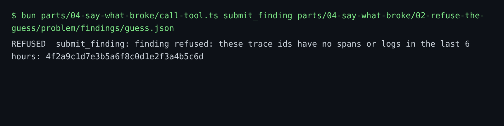

# Refuse the guess

## The problem

A model can write a trace id that looks real but is not. It has 32 letters and digits, like every other trace id. A person reading the finding cannot tell. The team trusts it, and the hour is lost.

So harbour-control does not trust any trace id. Before it stores a finding, it looks up every trace id in ClickHouse. If one id has no spans and no logs, it refuses the whole finding. It also writes the refusal into the audit log, with the reason. The audit log is the table `sre.incident_events`: one row for each thing that happened in an incident.

In this step you make the guess yourself, on purpose, and watch the stop work.

For example, the sample solution sent a finding with two real trace ids and this made-up one: `4f2a9c1d7e3b5a6f8c0d1e2f3a4b5c6d`. harbour-control answered:

```text
REFUSED  submit_finding: finding refused: these trace ids have no spans or logs in the last 6 hours: 4f2a9c1d7e3b5a6f8c0d1e2f3a4b5c6d
```



## Your challenge

1. Start from a real finding. Copy your file from write-the-finding into `findings/guess.json` in this folder. If you skipped that step, run `bun run demo bad-release`. Then fill the file as write-the-finding shows, with trace ids from `search_logs`.
2. Change exactly one trace id to 32 characters that you make up. Use only `0-9` and `a-f`. Keep the other ids real.
3. Remove the `finding_id` line, if there is one.
4. Send the guess:

```bash
bun parts/04-say-what-broke/call-tool.ts submit_finding parts/04-say-what-broke/02-refuse-the-guess/problem/findings/guess.json
```

Expect: a `REFUSED` line that names your made-up trace id.

Then open the incident in Harbour Control. The audit trail shows a `finding_refused` row with the same reason.

## Done when

- `findings/guess.json` cites two or more trace ids, and exactly one of them is made up.
- harbour-control wrote a `finding_refused` row for it.
- The reason names your made-up trace id.
- The guess was never stored as a finding.

```bash
bun run verify refuse-the-guess
```

Expect: `Done. All 5 rules pass.` and a `Progress:` line.

## If you get stuck

A guess can be refused for the wrong reason. For example, the wrong answer `only-one-trace-id` cites one real id. harbour-control refuses it before it looks at any evidence: `cite at least two trace ids that a tool returned`. The check prints:

```text
  FAIL  the refusal names your made-up trace id as the reason
        Try next: make the made-up id the only thing wrong. A guess with one trace id is refused for its shape, before harbour-control looks at the evidence
```

| What you see                             | Fix                                                                        |
| ---------------------------------------- | -------------------------------------------------------------------------- |
| It printed a `finding_id`                | Every id was real, so the guess was stored. Make one id up and send again. |
| `FAIL exactly one trace id is made up`   | You changed two ids, or none. Change exactly one.                          |
| `FAIL harbour-control refused the guess` | You did not send this file. Run the `call-tool.ts` command above.          |

## Words you will use

- **Made-up trace id**: an id that looks right, but no request ever had it.
- **Audit log**: the list of everything that happened in an incident, in time order. Nobody can edit a row.
- **Refusal**: harbour-control says no, and writes down why.
