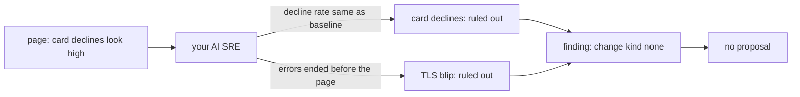

# Rule out the distractors

## The problem

Not every page means something is broken. Sometimes a person pages because a number looks high, and it is normal.

A distractor is a signal that looks like a cause, but is not. An AI SRE that always finds a cause is dangerous. It blames a distractor, and a change hits a healthy system.

So the right answer is sometimes "nothing changed". The finding still needs proof. It must name each distractor it checked, and say why it is not the cause.

For example, on the noisy-morning scenario, the ops desk pages: "Card declines look high this morning, can someone check payments?". Two signals look bad:

| Signal                                       | Why it is not the cause                                 |
| -------------------------------------------- | ------------------------------------------------------- |
| `card declined by payments gateway`          | about 1 in 30 cards is declined, the same as every hour |
| `TLS handshake failed with payments gateway` | the errors stopped about 30 minutes before the page     |



## Your challenge

1. Plant the scenario: `bun run world break noisy-morning`. A `manual_page` incident opens in Harbour Control at once. Copy its id.
2. Check both signals. Compare the decline rate now with the hour before. Search booking-web logs for TLS errors over the last 60 minutes, and look at when they stopped.
3. Fill in `findings/noisy-morning.json` in this folder:
   - `change` is `{"kind": "none", "value": ""}`;
   - `ruled_out` has one entry for each distractor, each with a `signal` and a `why`;
   - `trace_ids` holds two or more trace ids of booking-web requests since the page. Card decline lines carry trace ids.
4. Send it, and propose nothing:

```bash
bun parts/04-say-what-broke/call-tool.ts submit_finding parts/04-say-what-broke/03-rule-out-the-distractors/problem/findings/noisy-morning.json
```

Expect: a `finding_id`, written back into the file.

## Done when

- harbour-control stored the finding, for the noisy-morning page.
- `change` is `none`.
- `ruled_out` names the card declines and the old TLS blip, each with a reason.
- No change was proposed for this incident.

```bash
bun run verify rule-out-the-distractors
```

Expect: `Done. All 8 rules pass.` and a `Progress:` line.

## If you get stuck

The TLS errors are older than the page, so a short search misses them. For example, the wrong answer `forgets-the-old-blip` rules out only the card declines. The check prints:

```text
  FAIL  ruled_out names the old TLS blip
        Try next: search booking-web logs for the last 60 minutes. Look for TLS errors, check when they stopped, and add them to ruled_out
```

| What you see                             | Fix                                                                                |
| ---------------------------------------- | ---------------------------------------------------------------------------------- |
| `REFUSED ... began more than 15 minutes` | Cite trace ids from after the page, not the old TLS lines. Those have no trace id. |
| `FAIL change is {"kind": "none"}`        | A cert rotation that ended before the page is not the change. Say `none`.          |
| `FAIL no change was proposed`            | This incident has a proposal. Break noisy-morning again and use the new incident.  |

## Words you will use

- **Distractor**: a signal that looks like a cause, but is not.
- **Baseline**: how a number behaves on a normal day. You compare against it.
- **ruled_out**: the part of a finding that lists each signal you checked, and why it is not the cause.
