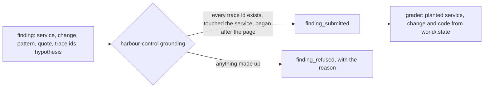

# Say what broke and prove it

## The problem

A wrong cause, said with confidence, sends the team the wrong way. So every claim of the AI SRE must point at evidence. The evidence must be something a script can look up.

The AI SRE writes its claim as a finding. A finding names the broken service, the change that caused it, and the proof. The proof has three parts:

- trace ids that exist in the incident window, the time when the incident happened;
- a log line, quoted word for word;
- the release or config that changed.

harbour-control checks every finding before it stores it. This is called grounding: each piece of evidence must be real. If a piece is made up, harbour-control refuses the finding and says why. For example, it refuses a finding with only one trace id and gives this reason: `cite at least two trace ids that a tool returned`.

Then a grader compares the finding with the fault that the course planted. The grader is code, not an AI.

For example, this is a real finding from the recorded bad-release morning, shortened:

```text
service:    booking-web
change:     release v2
quote:      connection pool exhausted: 2 of 2 connections in use (audit_trail) ref=HX-FQ7TPP
trace_ids:  d3155dd2299429ac40f0f022ed6852dc, 699c33a2ff95daf7c83df58a3e34e782, a097b23524793a17a256fa5bb11f5f5e
hypothesis: Release v2 of booking-web opens a new database connection for each booking's audit trail and holds it, so the two audit connections run out and bookings fail.
```

It matches the planted fault in `world/scenarios/bad-release.json`: service booking-web, change kind release, value v2.

Some signals look like a cause, but are not. They are distractors. For example, card declines happen in every scenario, at their usual rate. A good finding names them as ruled out.

Why it matters: IBM Research and Artificial Analysis published a test called ITBench-AA. It has 59 SRE tasks. Every model they tested scores below 50%. The source is the README of github.com/IBM/ITBench, read on the build date.

This picture shows the path of a finding:



## Steps

| Step                       | Minutes | You produce                                                              | The check reads                                                                                                |
| -------------------------- | ------- | ------------------------------------------------------------------------ | -------------------------------------------------------------------------------------------------------------- |
| `write-the-finding`        | 20      | `findings/bad-release.json` written by your agent through submit_finding | the stored finding: planted service and change, the planted verification code in the quote, trace ids grounded |
| `refuse-the-guess`         | 15      | a finding with one made-up trace id, sent on purpose                     | a finding_refused row in sre.incident_events with the reason                                                   |
| `rule-out-the-distractors` | 20      | the agent's finding for noisy-morning                                    | change kind none, and the card declines and the old TLS blip named in ruled_out                                |

## Walkthrough

TODO(part session): this part's own session builds the step folders, their checks and these commands.

This command checks the whole part. It has no steps yet.

```bash
bun run verify part say-what-broke
```

Expect: `Part say-what-broke is done: 0/0 steps pass.` until the part session adds the steps.

```bash
bun run verify write-the-finding
```

Expect: TODO(part session): the pass line of `write-the-finding`.

```bash
bun run verify refuse-the-guess
```

Expect: TODO(part session): the pass line of `refuse-the-guess`.

```bash
bun run verify rule-out-the-distractors
```

Expect: TODO(part session): the pass line of `rule-out-the-distractors`.
