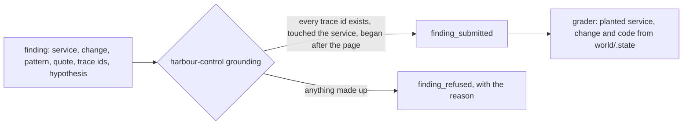

# Say what broke and prove it

## The problem

A wrong cause, said with confidence, sends the team the wrong way. So every claim of the AI SRE must point at evidence. The evidence must be something a script can look up.

The AI SRE writes its claim as a finding. A finding names the broken service, the change that caused it, and the proof. The proof has three parts:

- trace ids that exist in the incident window, the time when the incident happened;
- a log line, quoted word for word;
- the release or config that changed.

harbour-control checks every finding before it stores it. This is called grounding: each piece of evidence must be real. If a piece is made up, harbour-control refuses the finding and says why. For example, it refuses a finding with only one trace id and gives this reason: `cite at least two trace ids that a tool returned`.

Then a grader compares the finding with the fault that the course planted. The grader is code, not an AI.

For example, this is a real finding from the recorded bad-release morning, shortened:

```text
service:    booking-web
change:     release v2
quote:      connection pool exhausted: 2 of 2 connections in use (audit_trail) ref=HX-FQ7TPP
trace_ids:  d3155dd2299429ac40f0f022ed6852dc, 699c33a2ff95daf7c83df58a3e34e782, a097b23524793a17a256fa5bb11f5f5e
hypothesis: Release v2 of booking-web opens a new database connection for each booking's audit trail and holds it, so the two audit connections run out and bookings fail.
```

It matches the planted fault in `world/scenarios/bad-release.json`: service booking-web, change kind release, value v2.

Some signals look like a cause, but are not. They are distractors. For example, card declines happen in every scenario, at their usual rate. A good finding names them as ruled out.

Why it matters: IBM Research and Artificial Analysis published a test called ITBench-AA. It has 59 SRE tasks. Every model they tested scores below 50%. The source is IBM's own README at https://github.com/IBM/ITBench, read on the build date. So a finding from any model needs a check that does not trust the model.

This picture shows the path of a finding:



## Steps

| Step                       | Minutes | You produce                                                              | The check reads                                                                                                |
| -------------------------- | ------- | ------------------------------------------------------------------------ | -------------------------------------------------------------------------------------------------------------- |
| `write-the-finding`        | 20      | `findings/bad-release.json` written by your agent through submit_finding | the stored finding: planted service and change, the planted verification code in the quote, trace ids grounded |
| `refuse-the-guess`         | 15      | a finding with one made-up trace id, sent on purpose                     | a finding_refused row in sre.incident_events with the reason                                                   |
| `rule-out-the-distractors` | 20      | the agent's finding for noisy-morning                                    | change kind none, and the card declines and the old TLS blip named in ruled_out                                |

Every check reads what harbour-control stored, never what a model said. Your files only hold the ids, so the check can find the rows.

## Walkthrough

You send findings through your own AI SRE, or through `call-tool.ts`. It is a small MCP client in this part folder. It sends a JSON file to one harbour-control tool, so you need no model key.

Start the world, if it is not running.

```bash
bun run world
```

Expect: `The world is up: every service is healthy.`

Plant the bad release. Harbour Control at http://localhost:8090 opens an incident after about a minute.

```bash
bun run world break bad-release
```

Expect: `Planted bad-release. Harbour Control opens an incident when its detector sees it (about a minute).`

Find the incident id and the failing log lines.

```bash
bun parts/04-say-what-broke/call-tool.ts list_incidents '{"state": "open"}'
bun parts/04-say-what-broke/call-tool.ts search_logs '{"service": "booking-web", "text": "connection pool exhausted", "minutes": 10}'
```

Expect: an incident with `"rule":"error_rate"`, then log lines that end in `ref=HX-` and six letters, each with a `trace_id`.

Fill in `01-write-the-finding/problem/findings/bad-release.json` and send it.

```bash
bun parts/04-say-what-broke/call-tool.ts submit_finding parts/04-say-what-broke/01-write-the-finding/problem/findings/bad-release.json
```

Expect: `Wrote finding_id fnd-` and twelve characters `into` your file.

```bash
bun run verify write-the-finding
```

Expect: `Done. All 7 rules pass.`

Now copy that file to `02-refuse-the-guess/problem/findings/guess.json`. Make up one trace id, remove the `finding_id`, and send it.

```bash
bun parts/04-say-what-broke/call-tool.ts submit_finding parts/04-say-what-broke/02-refuse-the-guess/problem/findings/guess.json
```

Expect: `REFUSED  submit_finding: finding refused: these trace ids have no spans or logs in the last 6 hours:` and your made-up id.

```bash
bun run verify refuse-the-guess
```

Expect: `Done. All 5 rules pass.`

Heal the world, then page on-call about card declines.

```bash
bun run world heal
bun run world break noisy-morning
```

Expect: `Healed: booking-web runs v1, fares-41 is live, timetable-loader restarted.` then `Paged on-call about card declines.`

Fill in `03-rule-out-the-distractors/problem/findings/noisy-morning.json` with change `none` and both distractors, and send it.

```bash
bun parts/04-say-what-broke/call-tool.ts submit_finding parts/04-say-what-broke/03-rule-out-the-distractors/problem/findings/noisy-morning.json
```

Expect: `Wrote finding_id fnd-` and twelve characters `into` your file.

```bash
bun run verify rule-out-the-distractors
```

Expect: `Done. All 8 rules pass.`

This command checks the whole part.

```bash
bun run verify part say-what-broke
```

Expect: `Part say-what-broke is done: 3/3 steps pass.`

## Assignment

The problem: a confident wrong cause sends the team the wrong way for an hour.

Hand in these files from your repo:

- `01-write-the-finding/problem/findings/bad-release.json`, sent by your agent;
- `02-refuse-the-guess/problem/findings/guess.json`, the refused guess;
- `03-rule-out-the-distractors/problem/findings/noisy-morning.json`.

The rubric. Each line is yes or no:

| #   | Yes when                                                                               |
| --- | -------------------------------------------------------------------------------------- |
| 1   | `bun run verify write-the-finding` passes on your world.                               |
| 2   | `bun run verify refuse-the-guess` passes, and the refusal names the made-up id.        |
| 3   | `bun run verify rule-out-the-distractors` passes.                                      |
| 4   | Your bad-release finding has a `ruled_out` entry for the card declines, with a reason. |
| 5   | Your hypothesis is one sentence that says what fails, where, and why.                  |

For advanced learners: make your agent list what it could not check, in its hypothesis or in `ruled_out`. Then add a `ruled_out` entry for every distractor in `world/scenarios/noisy-morning.json`.

## Finished

You now have an AI SRE whose every claim is checked. It names the service and the change. It cites trace ids that exist, and a log line from this run. When it guesses, harbour-control refuses it and writes down why. On a quiet morning, it says "nothing changed" and lists what it ruled out.

A finding changes nothing in the world. Next, in ask-before-you-act, the AI SRE proposes one change for a stored finding. A named person approves it before anything runs.
