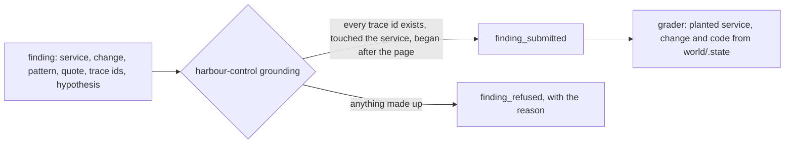

# Say what broke and prove it

## The problem

A confident wrong cause sends the team the wrong way. So every claim the AI SRE makes must point at evidence a script can look up: trace ids that exist in the incident window, a log line quoted word for word, and the release or config that changed. harbour-control refuses a finding whose evidence is not real, and the grader compares the finding with the planted fault in code.

Why it matters: IBM Research and Artificial Analysis published ITBench-AA with 59 SRE tasks, and every model they evaluated scores below 50% (github.com/IBM/ITBench README, read on the build date).



## Steps

| Step                       | Minutes | You produce                                                              | The check reads                                                                                                |
| -------------------------- | ------- | ------------------------------------------------------------------------ | -------------------------------------------------------------------------------------------------------------- |
| `write-the-finding`        | 20      | `findings/bad-release.json` written by your agent through submit_finding | the stored finding: planted service and change, the planted verification code in the quote, trace ids grounded |
| `refuse-the-guess`         | 15      | a finding with one made-up trace id, sent on purpose                     | a finding_refused row in sre.incident_events with the reason                                                   |
| `rule-out-the-distractors` | 20      | the agent's finding for noisy-morning                                    | change kind none, and the card declines and the old TLS blip named in ruled_out                                |

## Walkthrough

TODO(part session): the step folders, their checks and these commands are built in this part's own session.

```bash
bun run verify part say-what-broke
```

Expect: `Part say-what-broke is done: 0/0 steps pass.` until the part session adds the steps.

```bash
bun run verify write-the-finding
```

Expect: TODO(part session): the pass line of `write-the-finding`.

```bash
bun run verify refuse-the-guess
```

Expect: TODO(part session): the pass line of `refuse-the-guess`.

```bash
bun run verify rule-out-the-distractors
```

Expect: TODO(part session): the pass line of `rule-out-the-distractors`.
