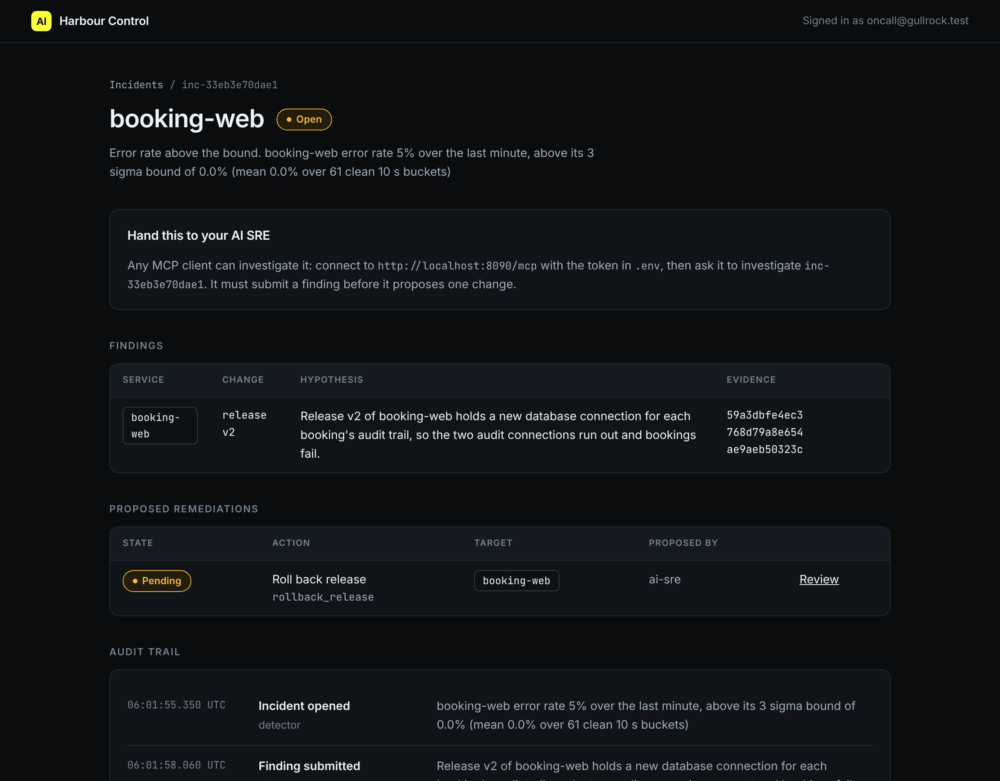

# Propose one change

## The problem

Your AI SRE found the cause of bad-release. Now it wants to fix it. If it can change production at once, one wrong guess becomes a second outage.

So at Gullrock the AI SRE can only propose. A proposal is one change, written down and stored, that waits for a person. harbour-control accepts a proposal only when:

- it rests on a stored finding for the same incident;
- its action and target are on the fixed list of actions in `policy.py`;
- it is the only live proposal for the incident.

For example, the sample solution proposed this change for a recorded bad-release incident:

```json
{
  "incident_id": "inc-f0ac746f5c16",
  "finding_id": "fnd-bac37db7a73c",
  "action": "rollback_release",
  "target": "booking-web",
  "params": { "release": "v1" },
  "action_id": "act-f8c3206aec14"
}
```

harbour-control stored it as `pending` and gave back the `action_id`. Nothing ran.



## Your challenge

1. Plant the fault: `bun run world break bad-release`. Wait for the incident in Harbour Control at http://localhost:8090.
2. Fill in `finding.json` in this folder and send it, as in write-the-finding. Your own AI SRE can do this, or you can use `call-tool.ts`.
3. Read the fixed list of actions. `get_incident` prints it as `allowed_actions`. Put your own incident id in place of `inc-...`:

```bash
bun parts/05-ask-before-you-act/call-tool.ts get_incident '{"incident_id": "inc-..."}'
```

Expect: one JSON reply with your incident, its findings and `allowed_actions`.

4. Fill in `change.json`. Use the `finding_id` from step 2. Pick the one action that undoes the change your finding blames.
5. Send it:

```bash
bun parts/05-ask-before-you-act/call-tool.ts submit_finding parts/05-ask-before-you-act/01-propose-one-change/problem/finding.json
bun parts/05-ask-before-you-act/call-tool.ts propose_remediation parts/05-ask-before-you-act/01-propose-one-change/problem/change.json
```

Expect: a `finding_id`, then an `action_id` with `"state":"pending"`, each written back into its file.

Do not approve it yet. The next step needs it pending.

## Done when

- `change.json` holds the `action_id`, and harbour-control stored the proposal.
- It rests on a stored finding for the same incident, and that finding blames booking-web release v2.
- It is the right change: `rollback_release` on `booking-web` to `v1`.
- It is the only proposal for the incident.

```bash
bun run verify propose-one-change
```

Expect: `Done. All 6 rules pass.` and a `Progress:` line.

## If you get stuck

A change can be on the list and still be wrong. For example, the wrong answer `restart-instead` proposes `restart_service` on booking-web. A restart keeps release v2 running, so the errors stay. The check prints:

```text
  FAIL  it is the right change for that fault: rollback_release booking-web to v1
        Try next: a restart keeps the broken release running. Ask for rollback_release on booking-web with params {"release": "v1"}
```

| What you see                                      | Fix                                                                                 |
| ------------------------------------------------- | ----------------------------------------------------------------------------------- |
| `REFUSED ... proposal refused: no stored finding` | Send the finding first, and copy its `finding_id` into `change.json`.               |
| `REFUSED ... is not allowed`                      | The action, target or params are not on the list. Copy them from `allowed_actions`. |
| The answer shows an older `action_id`             | A proposal is already live for this incident. Plant the fault again.                |

## Words you will use

- **Proposal**: one change the AI SRE asks for. It waits for a person.
- **Fixed list of actions**: the only changes harbour-control can ever run, in `policy.py`.
- **Pending**: stored, not yet approved or rejected.
