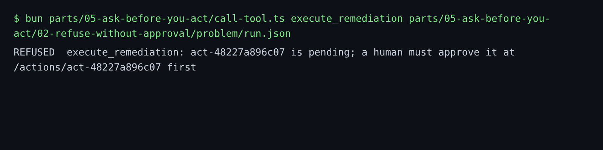

# Refuse without approval

## The problem

An agent that can propose a change can also try to run it. It can do so by mistake, because a prompt says "fix it", or because a log line tells it to. A rule in the prompt does not stop that. The model can ignore a prompt.

The stop must live in the server. At Gullrock, `execute_remediation` runs a change only after a person approved it. Any other attempt is refused, and the refusal goes into the audit log. The world does not change.

For example, the reference AI SRE tried to run its rollback right after it proposed it. harbour-control answered:

```text
REFUSED  execute_remediation: act-f8c3206aec14 is pending; a human must approve it at /actions/act-f8c3206aec14 first
```

The audit log got a `remediation_refused` row, with `{"state": "pending"}`. booking-web kept running release v2.



## Your challenge

1. Copy the `action_id` from propose-one-change into `run.json` in this folder. The proposal must still be pending.
2. Try to run it, as an agent would:

```bash
bun parts/05-ask-before-you-act/call-tool.ts execute_remediation parts/05-ask-before-you-act/02-refuse-without-approval/problem/run.json
```

Expect: `REFUSED  execute_remediation:` and `a human must approve it`.

3. Open http://localhost:8000. The footer still says `Release v2`. Nothing ran.
4. Open the incident in Harbour Control. The audit trail shows the refused attempt.

## Done when

- `run.json` names a stored proposal.
- harbour-control refused to run it while it was pending, and wrote a `remediation_refused` row.
- The refusal came before any approval.
- Nothing ran before a person approved it.

```bash
bun run verify refuse-without-approval
```

Expect: `Done. All 4 rules pass.` and a `Progress:` line.

## If you get stuck

Order matters. For example, the wrong answer `approved-first` approved the change before anyone tried to run it. So there is no refusal to show. The check prints:

```text
  FAIL  the attempt to run it was refused while it was pending: a remediation_refused row
        Try next: before anyone approves, run: bun parts/05-ask-before-you-act/call-tool.ts execute_remediation <path to run.json>. You should see a REFUSED line
```

| What you see                 | Fix                                                                           |
| ---------------------------- | ----------------------------------------------------------------------------- |
| The change ran               | It was already approved. Propose a new change for a new bad-release incident. |
| `REFUSED ... is expired`     | The incident closed on its own. Plant the fault again and propose again.      |
| `REFUSED ... no remediation` | The `action_id` is wrong. Copy it again from `change.json`.                   |

## Words you will use

- **Approval gate**: the rule in the server that no change runs without a person's yes.
- **Refusal row**: the audit log entry that says what was tried, and why it was refused.
- **Expired**: a pending proposal whose incident closed on its own. Nobody can approve it any more.
