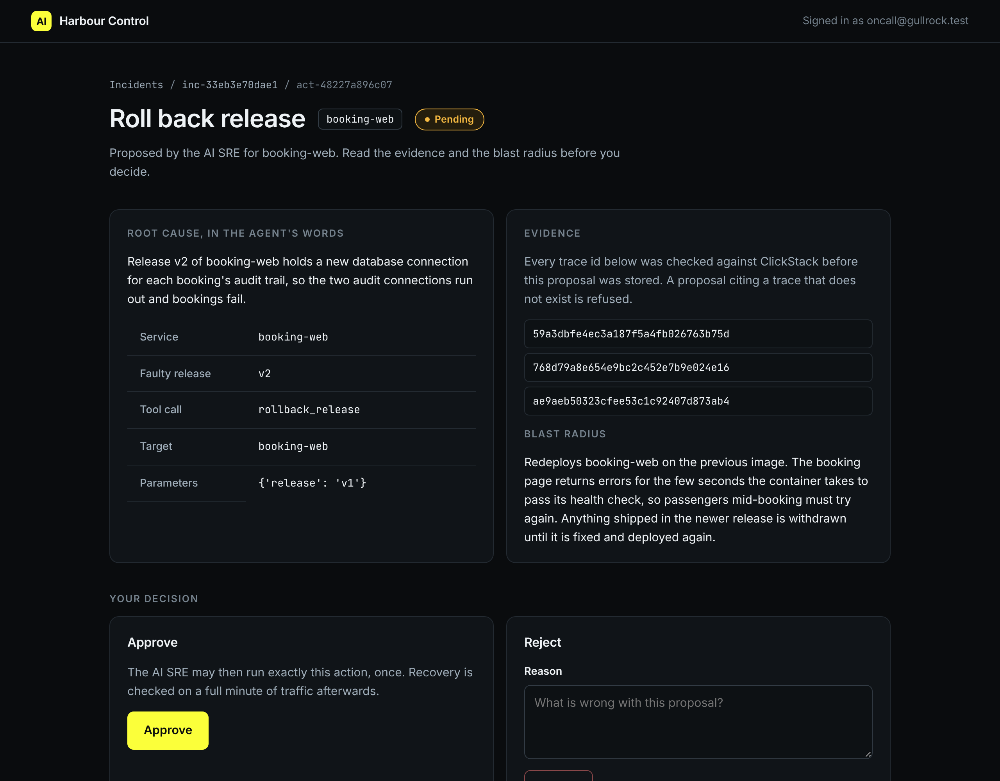

# Approve with blast radius

## The problem

An approval is worth something only if the approver reads what they approve. A person who clicks "Approve" on every request is not a stop.

The approval page in Harbour Control shows three things:

- the evidence: the finding and its trace ids;
- the change: the action, its target and its params;
- the blast radius: what else breaks, or who is affected, when it runs.

Your job is to read all three, and only then say yes. Your name goes into the audit log next to the approval.

For example, this is the blast radius of `rollback_release`. It comes from `world/harbour-control/harbour_control/policy.py`:

```text
Redeploys booking-web on the previous image. The booking page returns errors for the few seconds
the container takes to pass its health check, so passengers mid-booking must try again. Anything
shipped in the newer release is withdrawn until it is fixed and deployed again.
```



## Your challenge

1. Open your pending change at `http://localhost:8090/actions/<action_id>`. Sign in with `SRE_APPROVER_EMAIL` and `SRE_APPROVER_PASSWORD` from `.env`.
2. Open one of its trace ids in HyperDX at http://localhost:8080. Check that it is a failing booking on release v2.
3. Fill in `approval.md` in this folder:
   - `Action id:` the change you approve;
   - `Evidence:` the full trace id you opened;
   - `Blast radius:` the sentence about who is affected, copied from the page;
   - `Why I approve:` one sentence in your own words.
4. Press Approve. Or run this, which approves as the person in `.env`:

```bash
bun run approve --yes
```

Expect: `Approved act-` and the id, `as oncall@gullrock.test`.

## Done when

- `approval.md` names the action, and a person approved it: the actor is an email, not `ai-sre`.
- The approval came after the proposal.
- `Evidence` is a trace id of the finding behind the change.
- `Blast radius` is copied from this action's blast radius.

```bash
bun run verify approve-with-blast-radius
```

Expect: `Done. All 5 rules pass.` and a `Progress:` line.

## If you get stuck

Each action has its own blast radius. For example, the wrong answer `copied-the-wrong-box` copied the text of `restart_service` for a rollback. The check prints:

```text
  FAIL  you read the blast radius of this action: Blast radius is copied from the page
        Try next: copy the sentence about who is affected from the Blast radius box of this action's approval page
```

| What you see                       | Fix                                                             |
| ---------------------------------- | --------------------------------------------------------------- |
| `Nothing is waiting for approval.` | The proposal is gone or expired. Go back to propose-one-change. |
| `FAIL you read the evidence`       | Copy one full trace id from the Evidence box of this action.    |
| `FAIL a person approved it`        | Press Approve on the page, signed in as yourself.               |

## Words you will use

- **Approver**: the named person who says yes. The audit log keeps their email.
- **Blast radius**: what else breaks, or who is affected, when a change runs.
- **Evidence**: the finding and trace ids that the change rests on.
