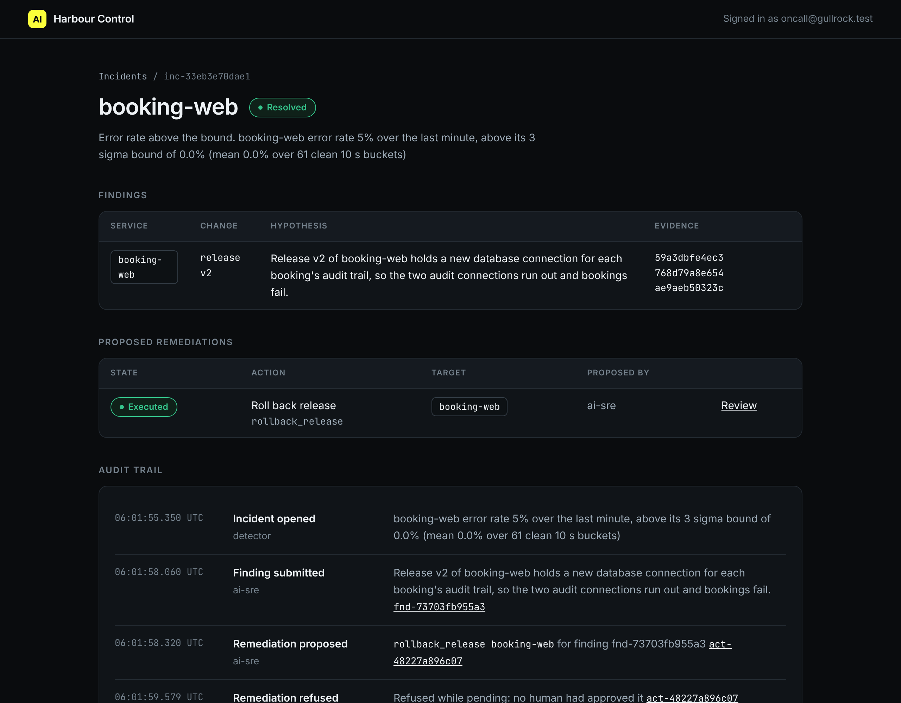

# Roll back the release

## The problem

A change that ran is not yet a fix. The fix is proven only when real traffic is healthy again. Many teams stop at "the deploy finished". Then the outage goes on, and nobody is watching.

At Gullrock, harbour-control watches for you. After an approved change runs, it waits one full minute of new requests. If the error rate is back under its bound, it writes `verification_passed` and resolves the incident. If not, it writes `verification_failed`, and the incident stays open.

For example, the recorded bad-release incident ended with these rows in the audit log:

```text
remediation_approved   oncall@gullrock.test
remediation_executed   ai-sre                rollback_release booking-web release v1
verification_passed    harbour-control       error rate 0.0 over 208 requests
incident_resolved      harbour-control       Recovery confirmed on a full minute of traffic
```



## Your challenge

1. Put the `action_id` of your approved rollback in `run.json` in this folder.
2. Run it once, as the AI SRE would:

```bash
bun parts/05-ask-before-you-act/call-tool.ts execute_remediation parts/05-ask-before-you-act/04-roll-back-the-release/problem/run.json
```

Expect: `"exit_code":0` in the result, and `Recovery is verified automatically over the next minute`.

3. Wait about 90 seconds. Open the incident in Harbour Control. It turns to Resolved.
4. Open http://localhost:8000. The footer reads `Release v1`.

## Done when

- `run.json` names a stored rollback of booking-web to v1.
- It ran after a person approved it.
- harbour-control wrote `verification_passed`, and the incident is resolved.
- booking-web runs release v1 again.

```bash
bun run verify roll-back-the-release
```

Expect: `Done. All 5 rules pass.` and a `Progress:` line.

## If you get stuck

A change can run and still not fix anything. For example, the wrong answer `restarted-instead` restarted booking-web. The restart ran, but release v2 kept failing. After five minutes, harbour-control wrote `verification_failed`. The check prints:

```text
  FAIL  harbour-control verified recovery on fresh traffic: verification_passed
        Try next: wait about 90 seconds after the change. harbour-control judges a full minute of new requests, then run this again
```

| What you see                   | Fix                                                                   |
| ------------------------------ | --------------------------------------------------------------------- |
| `REFUSED ... is pending`       | Approve it first, in approve-with-blast-radius.                       |
| `FAIL ... verification_passed` | Wait 90 seconds. If it says failed, the change did not fix the fault. |
| The footer still says `v2`     | The rollback did not run. Read the result of `execute_remediation`.   |

## Words you will use

- **Rollback**: running the previous release again, to undo the newer one.
- **Verification**: harbour-control's check of fresh traffic after a change.
- **Resolved**: the incident is closed because recovery was proven, not because someone said so.
